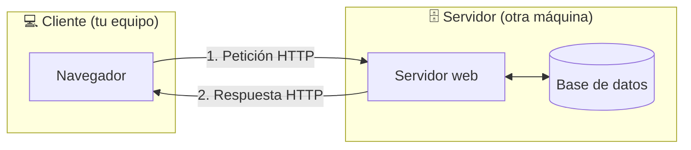
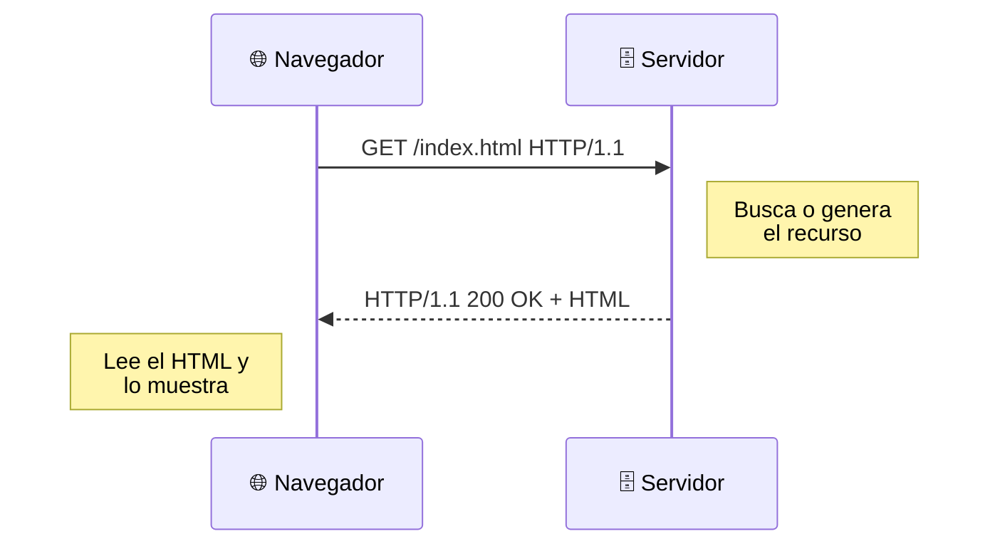
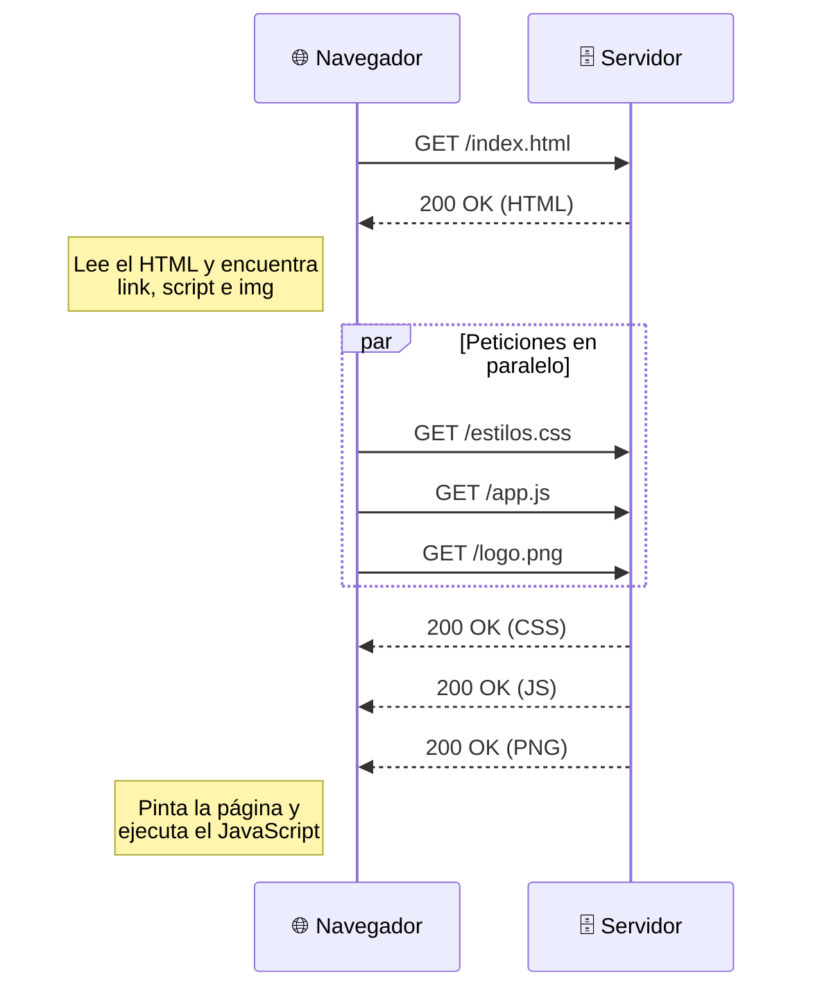
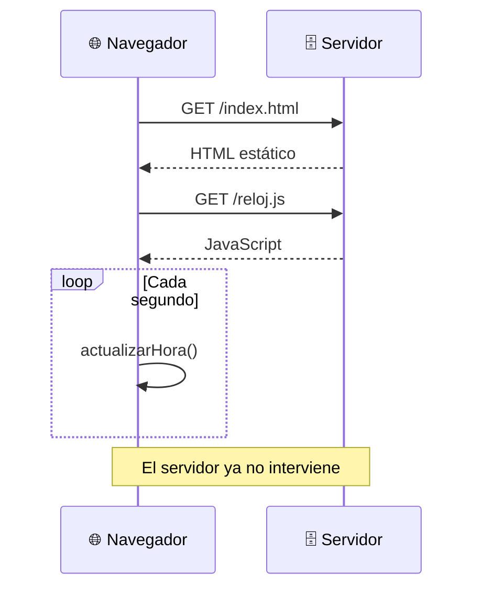
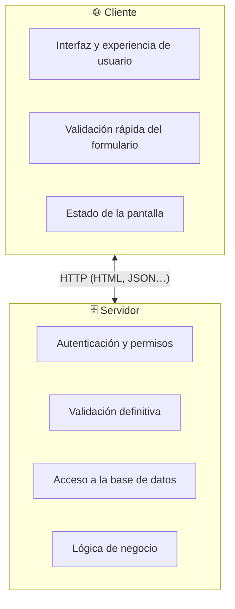
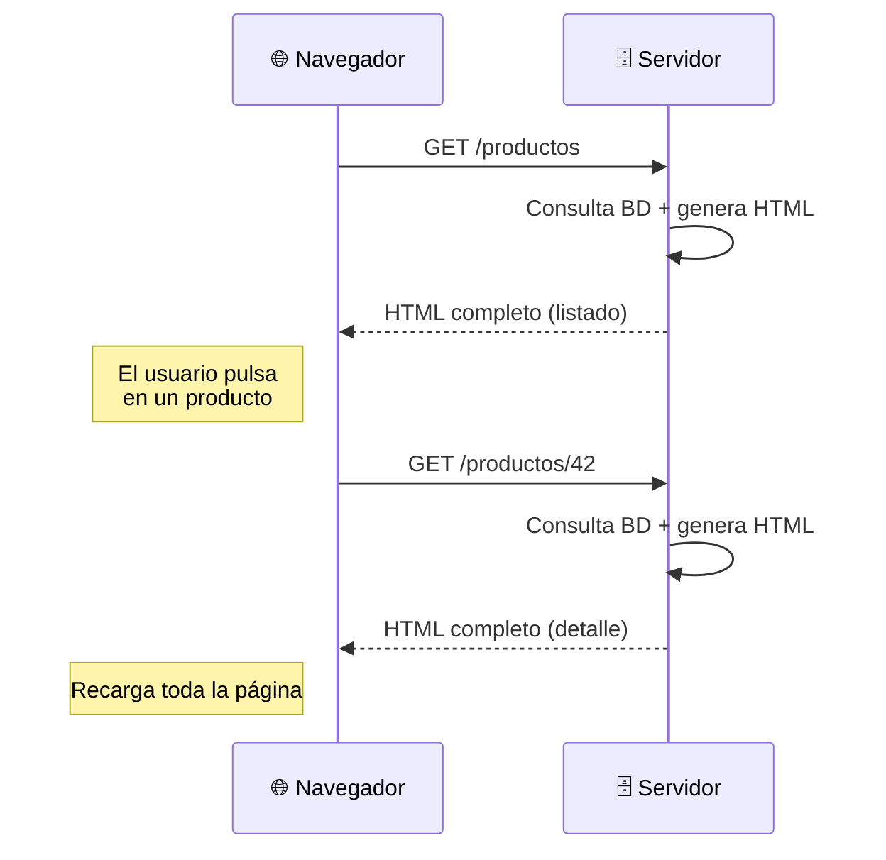
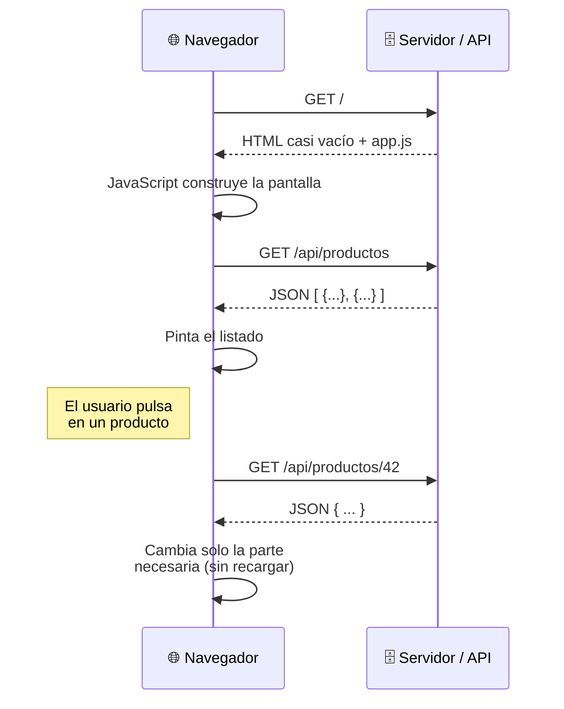
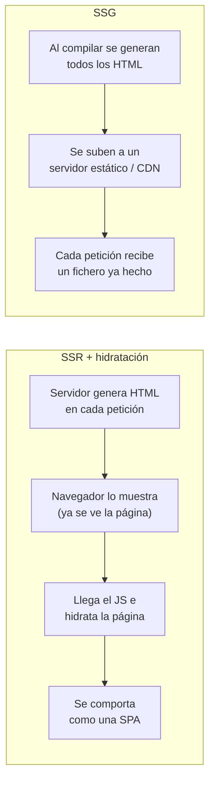
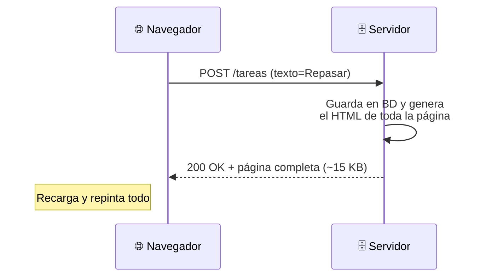
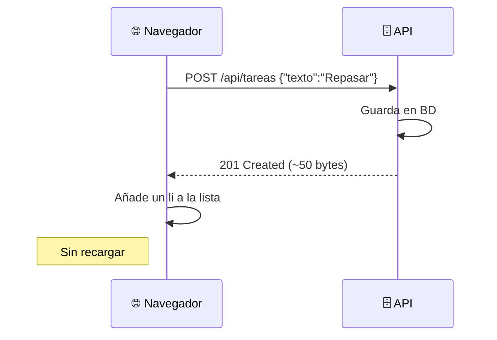

# 1. Cliente y servidor: dónde se ejecuta el código

[⬅️ Volver a la unidad](./README.md)

## Índice

- [1.1. La web es una conversación](#11-la-web-es-una-conversación)
- [1.2. El protocolo HTTP: petición y respuesta](#12-el-protocolo-http-petición-y-respuesta)
  - [1.2.1. Anatomía de una petición](#121-anatomía-de-una-petición)
  - [1.2.2. Anatomía de una respuesta](#122-anatomía-de-una-respuesta)
  - [1.2.3. Una página, muchas peticiones](#123-una-página-muchas-peticiones)
- [1.3. Código que se ejecuta en el servidor](#13-código-que-se-ejecuta-en-el-servidor)
- [1.4. Código que se ejecuta en el cliente](#14-código-que-se-ejecuta-en-el-cliente)
- [1.5. Servidor frente a cliente: comparativa](#15-servidor-frente-a-cliente-comparativa)
- [1.6. Modelos de aplicación web](#16-modelos-de-aplicación-web)
  - [1.6.1. MPA con renderizado en servidor (SSR clásico)](#161-mpa-con-renderizado-en-servidor-ssr-clásico)
  - [1.6.2. SPA con renderizado en cliente (CSR)](#162-spa-con-renderizado-en-cliente-csr)
  - [1.6.3. Modelos híbridos: SSR con hidratación y SSG](#163-modelos-híbridos-ssr-con-hidratación-y-ssg)
  - [1.6.4. ¿Cuál elijo?](#164-cuál-elijo)
- [1.7. Ejemplo integrador: la misma lista de tareas en dos arquitecturas](#17-ejemplo-integrador-la-misma-lista-de-tareas-en-dos-arquitecturas)
- [Resumen](#resumen)
- [Ejercicios de reflexión](#ejercicios-de-reflexión)

> **CE que trabaja este tema:** RA1 a.

---

## 1.1. La web es una conversación

Cuando escribes `https://www.ejemplo.com` en el navegador y pulsas Intro, empieza una **conversación** entre dos programas:

- El **cliente** (*client*): el programa que pide. En la web, casi siempre es un **navegador** (Chrome, Firefox, Safari, Edge…), aunque también puede ser una app móvil o un programa como `curl`.
- El **servidor** (*server*): el programa que responde. Está en otra máquina, espera peticiones y devuelve recursos: páginas HTML, hojas de estilo, imágenes, datos en JSON…

Esta forma de organizar un sistema se llama **arquitectura cliente-servidor**.



Fíjate en que el cliente **nunca** accede directamente a la base de datos: siempre pide al servidor, y es el servidor quien decide qué devuelve.

> 📝 **Nota del Profesor**: Toda esta unidad (y en realidad todo el módulo) gira alrededor de una pregunta: **¿esto se ejecuta en el servidor o en el cliente?** Cada vez que veas un trozo de código, hazte esa pregunta. Este módulo trata del código que se ejecuta en el cliente; su compañero, *Desarrollo Web en Entorno Servidor*, trata del otro lado.

---

## 1.2. El protocolo HTTP: petición y respuesta

El "idioma" de esa conversación es **HTTP** (*HyperText Transfer Protocol*), o **HTTPS** cuando va cifrada. Es un protocolo de **petición-respuesta**: el cliente siempre habla primero y el servidor contesta. El servidor nunca "llama" al cliente por su cuenta (para eso existen otras tecnologías, como WebSockets).



### 1.2.1. Anatomía de una petición

Una petición HTTP es texto con esta forma:

```http
GET /productos?categoria=libros HTTP/1.1
Host: www.ejemplo.com
User-Agent: Mozilla/5.0 (X11; Linux x86_64) Firefox/140.0
Accept: text/html
Accept-Language: es-ES,es;q=0.9
```

| Parte | Ejemplo | Significado |
|-------|---------|-------------|
| **Método** | `GET` | Qué quiere hacer el cliente: `GET` (leer), `POST` (enviar/crear), `PUT`/`PATCH` (modificar), `DELETE` (borrar) |
| **Ruta** | `/productos?categoria=libros` | Qué recurso pide, con parámetros opcionales tras `?` |
| **Versión** | `HTTP/1.1` | Versión del protocolo |
| **Cabeceras** | `Accept: text/html` | Información extra: qué formatos acepta, idioma, cookies… |
| **Cuerpo** | *(vacío en un GET)* | Datos que se envían, por ejemplo al rellenar un formulario con `POST` |

### 1.2.2. Anatomía de una respuesta

```http
HTTP/1.1 200 OK
Content-Type: text/html; charset=utf-8
Content-Length: 1256
Cache-Control: max-age=3600

<!doctype html>
<html lang="es">
  <head><title>Libros</title></head>
  <body>...</body>
</html>
```

La primera línea lleva el **código de estado**, que resume cómo ha ido:

| Rango | Significado | Ejemplos |
|-------|-------------|----------|
| `2xx` | Todo bien | `200 OK`, `201 Created`, `204 No Content` |
| `3xx` | Redirección | `301 Moved Permanently`, `304 Not Modified` |
| `4xx` | Error del **cliente** | `400 Bad Request`, `401 Unauthorized`, `403 Forbidden`, `404 Not Found` |
| `5xx` | Error del **servidor** | `500 Internal Server Error`, `503 Service Unavailable` |

La cabecera `Content-Type` es clave: le dice al navegador **qué tipo de contenido** recibe (`text/html`, `text/css`, `application/javascript`, `application/json`, `image/png`…) y, por tanto, qué debe hacer con él.

> 💡 **Tip del Examinador**: Pregunta clásica: "¿Qué indica un 404 y qué indica un 500?". El 404 es un error del **cliente** (ha pedido algo que no existe); el 500 es un error del **servidor** (algo ha fallado al generar la respuesta). Acuérdate: 4 → culpa tuya, 5 → culpa suya.

### 1.2.3. Una página, muchas peticiones

Una página web casi nunca es un solo fichero. El navegador pide primero el HTML y, al leerlo, descubre que necesita más recursos (CSS, JS, imágenes, fuentes) y los va pidiendo:



**Compruébalo tú mismo:** abre cualquier web, pulsa `F12` para abrir las herramientas de desarrollo (*DevTools*), ve a la pestaña **Red** (*Network*) y recarga con `Ctrl+R`. Verás cada petición con su método, su código de estado, su tipo y su tamaño.

> ✅ **Buena práctica**: Acostúmbrate desde hoy a tener las DevTools abiertas mientras programas. La pestaña Red te dirá qué se ha pedido, qué ha llegado y qué ha fallado.

---

## 1.3. Código que se ejecuta en el servidor

En el modelo clásico, cuando el servidor recibe una petición **ejecuta un programa** que genera el HTML en ese momento. El navegador solo recibe el resultado: **nunca ve el código** que lo generó.

Ejemplo: una página que saluda y muestra la hora, hecha con **Node.js** en el servidor:

```js
// servidor.js — se ejecuta en el SERVIDOR con: node servidor.js
import { createServer } from 'node:http';

const servidor = createServer((peticion, respuesta) => {
  const hora = new Date().toLocaleTimeString('es-ES');

  // El HTML se construye aquí, en el servidor
  const html = `
    <!doctype html>
    <html lang="es">
      <body>
        <h1>Hola desde el servidor</h1>
        <p>Son las ${hora}</p>
      </body>
    </html>`;

  respuesta.writeHead(200, { 'Content-Type': 'text/html; charset=utf-8' });
  respuesta.end(html);
});

servidor.listen(3000, () => console.log('✅ Servidor en http://localhost:3000'));
```

Si abres `http://localhost:3000` y pulsas `Ctrl+U` (ver código fuente), verás esto:

```html
<!doctype html>
<html lang="es">
  <body>
    <h1>Hola desde el servidor</h1>
    <p>Son las 10:42:07</p>
  </body>
</html>
```

No hay ni rastro de `new Date()` ni de `createServer`: el navegador ha recibido **HTML ya terminado**. La hora es la **del servidor**, no la de tu equipo. Y si quieres que se actualice, tienes que **recargar la página** (nueva petición, nueva ejecución en el servidor).

El mismo ejemplo se podría escribir en PHP, Java, Python, C#… Al navegador le da igual: solo recibe HTML.

```php
<!-- index.php — también se ejecuta en el SERVIDOR -->
<h1>Hola desde el servidor</h1>
<p>Son las <?= date('H:i:s') ?></p>
```

---

## 1.4. Código que se ejecuta en el cliente

Ahora hacemos lo mismo, pero dejando que sea **el navegador** quien calcule la hora. El servidor solo envía ficheros **estáticos** (siempre iguales):

```html
<!-- index.html — el servidor lo envía tal cual -->
<!doctype html>
<html lang="es">
  <head>
    <meta charset="utf-8" />
    <title>Reloj en el cliente</title>
    <script src="reloj.js" defer></script>
  </head>
  <body>
    <h1>Hola desde el cliente</h1>
    <p>Son las <span id="hora">--:--:--</span></p>
  </body>
</html>
```

```js
// reloj.js — se ejecuta en el NAVEGADOR
const spanHora = document.querySelector('#hora');

function actualizarHora() {
  spanHora.textContent = new Date().toLocaleTimeString('es-ES');
}

actualizarHora();                  // la pinta nada más cargar
setInterval(actualizarHora, 1000); // y la actualiza cada segundo
```

Diferencias importantes con el ejemplo anterior:

1. La hora es **la de tu equipo**, no la del servidor.
2. La hora **se actualiza sola** cada segundo, **sin recargar** y sin hacer ninguna petición más al servidor.
3. Si pulsas `Ctrl+U` **sí verás** el código JavaScript: el navegador lo ha descargado para poder ejecutarlo.



> ⚠️ **Cuidado**: Todo lo que envías al cliente **lo puede leer y modificar el usuario**. Nunca pongas en el JavaScript del cliente contraseñas, claves de API privadas ni validaciones de las que dependa la seguridad. Una validación en el cliente mejora la experiencia de usuario, pero **el servidor siempre debe volver a validar**.

---

## 1.5. Servidor frente a cliente: comparativa

| Aspecto | Código en el servidor | Código en el cliente |
|---------|-----------------------|----------------------|
| **Dónde se ejecuta** | En la máquina del servidor | En el navegador del usuario |
| **Lenguajes** | Cualquiera: PHP, Java, Python, C#, JavaScript (Node.js), Go… | JavaScript (y lo que se compila a él o a WebAssembly) |
| **Quién ve el código** | Nadie fuera del servidor | Cualquier usuario (`Ctrl+U`, DevTools) |
| **Acceso a datos** | Base de datos, ficheros, otros servicios | Solo lo que el servidor le envíe y el almacenamiento del navegador |
| **Coste de cada acción** | Una petición de red (lento, carga el servidor) | Inmediato, sin red (rápido, gratis para el servidor) |
| **Interactividad** | Baja: hay que recargar la página | Alta: responde al instante a clics, teclas… |
| **Seguridad** | Entorno controlado | Entorno hostil: el usuario puede manipularlo |
| **Depende de…** | La potencia del servidor | La potencia del dispositivo y del navegador |
| **Ejemplos típicos** | Autenticación, pagos, consultas a la BD, lógica de negocio | Validar formularios al escribir, menús, animaciones, mapas, juegos |

La respuesta a "¿dónde lo pongo?" casi nunca es "solo en uno de los dos": las aplicaciones reales **reparten** el trabajo.



> 💡 **Tip del Examinador**: Si te preguntan dónde validar un formulario, la respuesta completa es **"en los dos"**: en el cliente para dar respuesta inmediata al usuario, y en el servidor porque es el único sitio donde la validación es fiable.

---

## 1.6. Modelos de aplicación web

Según **quién construye el HTML** que ve el usuario, hay varios modelos. Conocerlos es imprescindible para elegir tecnologías (y es justo lo que pide el RA1).

### 1.6.1. MPA con renderizado en servidor (SSR clásico)

**MPA** (*Multi-Page Application*): cada pantalla es una página distinta que genera el servidor. Cada clic en un enlace o envío de formulario **pide una página nueva completa** y el navegador la recarga entera.



- ✅ Primera carga rápida, muy buen **SEO** (los buscadores reciben HTML completo), funciona incluso sin JavaScript.
- ❌ Cada acción recarga la página (parpadeo, pérdida de estado) y el servidor trabaja en cada clic.
- Ejemplos: blogs con WordPress, webs institucionales, muchas tiendas online clásicas.

### 1.6.2. SPA con renderizado en cliente (CSR)

**SPA** (*Single-Page Application*): el servidor envía **una sola página HTML casi vacía** y un paquete de JavaScript. A partir de ahí, **el navegador construye todas las pantallas**, y solo pide **datos** (normalmente JSON) al servidor.



El HTML que recibe el navegador en una SPA típica es así de pobre:

```html
<!doctype html>
<html lang="es">
  <head><script type="module" src="/assets/app-3f9a1c.js"></script></head>
  <body>
    <div id="app"></div> <!-- JavaScript lo rellenará todo -->
  </body>
</html>
```

- ✅ Navegación instantánea, sensación de aplicación nativa, el servidor solo sirve datos.
- ❌ Primera carga más lenta (hay que descargar y ejecutar el JS), peor SEO si no se hace nada más, no funciona sin JavaScript.
- Ejemplos: Gmail, Google Maps, paneles de administración. Angular (UD8), React y Vue se usan a menudo así.

### 1.6.3. Modelos híbridos: SSR con hidratación y SSG

Los frameworks modernos combinan lo mejor de ambos mundos:

- **SSR con hidratación** (*hydration*): el servidor genera el HTML completo de la primera pantalla (rápido y buen SEO) **y además** envía el JavaScript. Cuando llega, el JS "despierta" ese HTML y la página pasa a comportarse como una SPA. Lo ofrecen Angular, Next.js (React), Nuxt (Vue), SvelteKit…
- **SSG** (*Static Site Generation*): las páginas se generan **una sola vez al compilar** el proyecto y se sirven como ficheros estáticos. Ideal para documentación y blogs. Ejemplos: Astro, VitePress, Hugo.



### 1.6.4. ¿Cuál elijo?

| Necesidad | Modelo recomendado |
|-----------|--------------------|
| Contenido que cambia poco (documentación, blog, portfolio) | **SSG** |
| Contenido público que debe posicionar en buscadores y cambia a menudo (tienda, periódico) | **SSR** (clásico o con hidratación) |
| Aplicación privada tras un login, muy interactiva (panel, gestor, correo) | **SPA / CSR** |
| Web sencilla con algo de interactividad (formulario de contacto, menú) | **MPA + JavaScript puntual** |

> 📝 **Nota del Profesor**: En este módulo empezarás por el último caso (HTML + JavaScript puntual) para entender bien el lenguaje y el navegador, y terminarás construyendo una SPA con Angular en la UD8. Nada de lo que hace un framework es magia: es JavaScript como el que vas a escribir a mano durante el curso.

> 💡 **Tip del Examinador**: Diferencia entre SPA y MPA en una frase: en una **MPA** el servidor envía una página nueva en cada navegación; en una **SPA** el servidor envía una sola página y después solo datos, y es el cliente quien cambia lo que se ve.

---

## 1.7. Ejemplo integrador: la misma lista de tareas en dos arquitecturas

Queremos una lista de tareas en la que se pueden añadir tareas nuevas. Vamos a comparar **qué viaja por la red** en cada modelo al añadir una tarea.

**Versión MPA (servidor):** el formulario se envía al servidor, que guarda la tarea y devuelve **la página entera** otra vez.

```html
<!-- HTML generado por el servidor -->
<ul>
  <li>Estudiar HTTP</li>
  <li>Instalar Docker</li>
</ul>
<form method="post" action="/tareas">
  <input name="texto" required />
  <button>Añadir</button>
</form>
```



**Versión SPA (cliente):** JavaScript intercepta el envío, manda **solo el dato** y añade el `<li>` sin recargar.

```js
// tareas.js — se ejecuta en el navegador
const formulario = document.querySelector('form');
const lista = document.querySelector('ul');

formulario.addEventListener('submit', async (evento) => {
  evento.preventDefault(); // ❌ no recargues la página
  const texto = formulario.texto.value;

  // Solo viajan los datos, en JSON
  await fetch('/api/tareas', {
    method: 'POST',
    headers: { 'Content-Type': 'application/json' },
    body: JSON.stringify({ texto }),
  });

  // El cliente actualiza la pantalla
  const li = document.createElement('li');
  li.textContent = texto;
  lista.append(li);
  formulario.reset();
});
```



No te preocupes todavía por entender cada línea del JavaScript: `addEventListener` lo verás en la UD6 y `fetch` en la UD7. Lo importante ahora es **la arquitectura**: en la versión MPA el servidor hace casi todo; en la SPA, el cliente se encarga de la interfaz y el servidor solo de los datos.

---

## Resumen

- La web sigue una **arquitectura cliente-servidor**: el cliente (navegador) pide y el servidor responde.
- Se comunican con **HTTP**: peticiones con método, ruta y cabeceras; respuestas con código de estado, cabeceras y cuerpo.
- El **código de servidor** genera la respuesta y el usuario no lo ve; el **código de cliente** se descarga y se ejecuta en el navegador, y el usuario sí lo ve y lo puede modificar.
- Nunca confíes en el cliente para la seguridad: **valida también en el servidor**.
- Modelos de aplicación: **MPA/SSR** (páginas generadas en el servidor), **SPA/CSR** (el cliente construye las pantallas y pide JSON), **SSR con hidratación** y **SSG**.
- Elegir modelo depende del SEO, la interactividad, el tipo de contenido y el tipo de usuario.

> 📝 **Nota del Profesor**: Si solo te llevas una idea de este tema, que sea el diagrama de la SPA: HTML casi vacío, JavaScript que construye la pantalla y peticiones que solo traen datos. Es el modelo al que llegarás en la UD8.

## Ejercicios de reflexión

1. Abre la pestaña **Red** de las DevTools en tres webs que uses a diario. ¿Cuántas peticiones hace cada una al cargar? ¿Cuál pesa más y por qué?
2. Entra en una web de noticias y en Gmail (u otro correo web). Pulsa `Ctrl+U` en cada una. ¿Cuál te parece una MPA y cuál una SPA? Justifícalo con lo que ves en el código fuente.
3. Piensa en una aplicación de banca online. Enumera tres cosas que harías en el cliente y tres que **obligatoriamente** harías en el servidor.
4. ¿Por qué crees que una tienda online grande no suele ser una SPA pura? ¿Qué modelo le recomendarías?

---

[⬅️ Volver a la unidad](./README.md)
