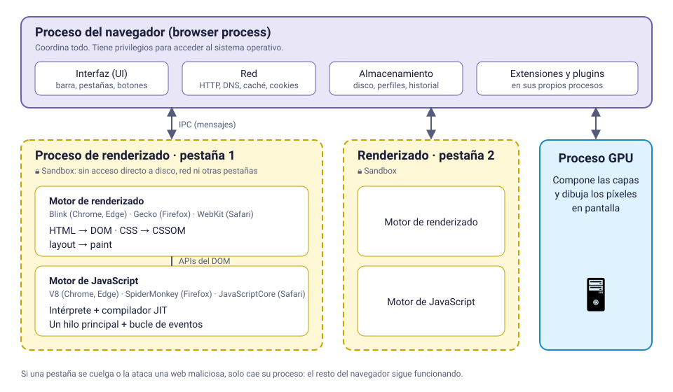
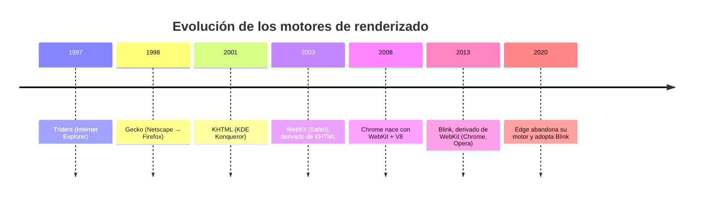
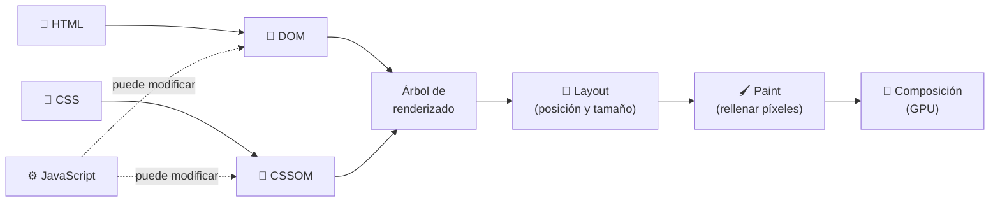
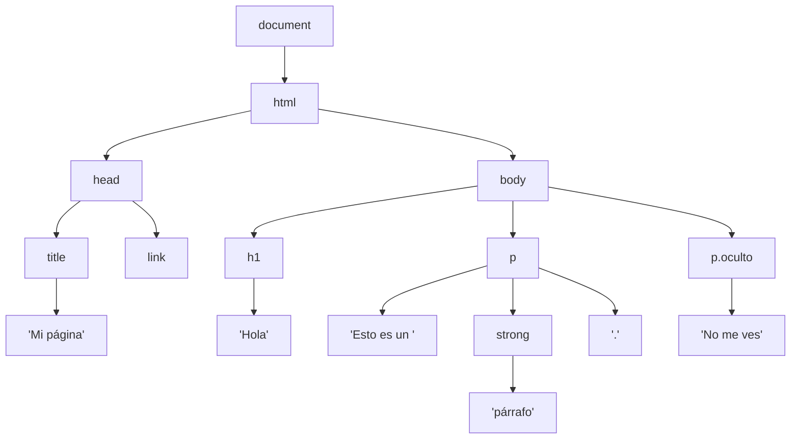
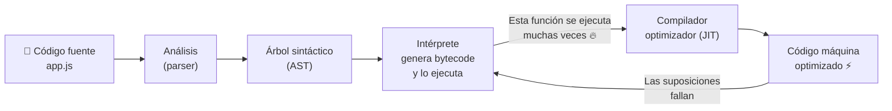
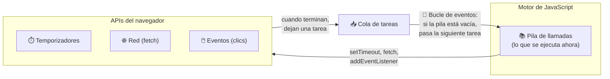

# 2. El navegador por dentro

[⬅️ Volver a la unidad](./README.md)

## Índice

- [2.1. Un navegador es mucho más que una ventana](#21-un-navegador-es-mucho-más-que-una-ventana)
- [2.2. Arquitectura de un navegador moderno](#22-arquitectura-de-un-navegador-moderno)
- [2.3. Motores de renderizado y de JavaScript](#23-motores-de-renderizado-y-de-javascript)
- [2.4. De HTML a píxeles: la ruta de renderizado](#24-de-html-a-píxeles-la-ruta-de-renderizado)
  - [2.4.1. Construcción del DOM](#241-construcción-del-dom)
  - [2.4.2. Construcción del CSSOM](#242-construcción-del-cssom)
  - [2.4.3. Árbol de renderizado, layout y paint](#243-árbol-de-renderizado-layout-y-paint)
  - [2.4.4. ¿Qué pasa cuando JavaScript cambia algo?](#244-qué-pasa-cuando-javascript-cambia-algo)
- [2.5. Cómo ejecuta JavaScript el navegador](#25-cómo-ejecuta-javascript-el-navegador)
  - [2.5.1. Interpretación y compilación JIT](#251-interpretación-y-compilación-jit)
  - [2.5.2. Un solo hilo](#252-un-solo-hilo)
  - [2.5.3. El bucle de eventos (visión general)](#253-el-bucle-de-eventos-visión-general)
- [2.6. Capacidades del JavaScript en el navegador](#26-capacidades-del-javascript-en-el-navegador)
- [2.7. Limitaciones y seguridad](#27-limitaciones-y-seguridad)
  - [2.7.1. La sandbox](#271-la-sandbox)
  - [2.7.2. La política del mismo origen](#272-la-política-del-mismo-origen)
  - [2.7.3. Permisos del usuario](#273-permisos-del-usuario)
- [2.8. Ejemplo integrador: observar al navegador trabajando](#28-ejemplo-integrador-observar-al-navegador-trabajando)
- [Resumen](#resumen)
- [Ejercicios de reflexión](#ejercicios-de-reflexión)

> **CE que trabaja este tema:** RA1 b.

---

## 2.1. Un navegador es mucho más que una ventana

Para el usuario, un navegador es una ventana con una barra de direcciones. Para ti, como programador de cliente, es tu **plataforma de ejecución**: igual que un programa de Java se ejecuta en la JVM, tu código JavaScript se ejecuta **dentro del navegador**, con lo que el navegador le permita hacer.

Un navegador moderno hace, como mínimo, todo esto:

1. **Descargar** recursos por la red (HTTP, caché, cookies).
2. **Interpretar** HTML y CSS y **dibujar** la página.
3. **Ejecutar** JavaScript y ofrecerle APIs para manipular la página, guardar datos, hacer peticiones…
4. **Proteger** al usuario de páginas maliciosas.
5. **Aislar** unas pestañas de otras.

> 📝 **Nota del Profesor**: Entender cómo trabaja el navegador te va a ahorrar horas de depuración. Muchos errores típicos del curso ("mi script no encuentra el elemento", "la página se congela", "me da error de CORS") se explican con lo que ves en este tema.

---

## 2.2. Arquitectura de un navegador moderno

Los navegadores actuales son **multiproceso**: en lugar de ser un único programa, lanzan varios procesos del sistema operativo que colaboran entre sí.



- **Proceso del navegador** (*browser process*): el "jefe". Dibuja la interfaz (barra, pestañas), gestiona la red y el disco. Es el único con permisos amplios sobre el sistema.
- **Procesos de renderizado** (*renderer processes*): normalmente uno por pestaña o por sitio web. Aquí viven el **motor de renderizado** y el **motor de JavaScript**. Se ejecutan en una **sandbox** con permisos muy limitados.
- **Proceso GPU**: compone las capas de la página y las dibuja en pantalla usando la tarjeta gráfica.

Los procesos se comunican entre sí enviándose mensajes (**IPC**, *Inter-Process Communication*). Por ejemplo, cuando tu JavaScript hace una petición de red, el proceso de renderizado **no** abre la conexión: se lo pide al proceso del navegador.

**Compruébalo:** en Chrome o Edge, pulsa `Mayús+Esc` para abrir el **administrador de tareas del navegador**. Verás un proceso por pestaña, otro para la GPU, otros para extensiones…

> 💡 **Tip del Examinador**: "¿Por qué si una pestaña se cuelga no se cuelga todo el navegador?" → Porque cada pestaña (o sitio) se ejecuta en su **propio proceso de renderizado**, aislado de los demás.

---

## 2.3. Motores de renderizado y de JavaScript

Dentro de cada proceso de renderizado hay dos piezas fundamentales:

- El **motor de renderizado** (*rendering engine* o *browser engine*): lee HTML y CSS, construye la estructura de la página y calcula cómo se dibuja.
- El **motor de JavaScript** (*JavaScript engine*): ejecuta tu código JavaScript.

| Navegador | Motor de renderizado | Motor de JavaScript |
|-----------|----------------------|---------------------|
| Google Chrome | Blink | V8 |
| Microsoft Edge | Blink | V8 |
| Opera, Brave, Vivaldi | Blink | V8 |
| Mozilla Firefox | Gecko | SpiderMonkey |
| Apple Safari | WebKit | JavaScriptCore |



Fíjate en que hoy en día, en la práctica, hay **tres familias** de motores (Blink, Gecko y WebKit). Por eso, cuando pruebes una aplicación, basta con probarla en un navegador de cada familia (esto lo automatizarás con Playwright en el tema 6 y en la UD5).

> ⚠️ **Cuidado**: En iOS (iPhone, iPad), por norma de Apple, históricamente **todos** los navegadores usaban WebKit por dentro, aunque se llamen Chrome o Firefox. Si algo falla "en el Chrome del iPhone", en realidad está fallando en WebKit.

**Motores de JavaScript fuera del navegador.** V8 es tan bueno que se sacó del navegador para crear **Node.js** (2009): el mismo motor, pero con APIs para leer ficheros, abrir puertos de red, etc. Por eso puedes ejecutar JavaScript en tu terminal y en servidores. Es lo que usarás para instalar herramientas con `npm` en el tema 5.

---

## 2.4. De HTML a píxeles: la ruta de renderizado

¿Qué hace exactamente el navegador desde que recibe el HTML hasta que ves la página? Sigue una secuencia de pasos llamada **ruta crítica de renderizado** (*critical rendering path*).



Vamos a seguirlo con esta página de ejemplo:

```html
<!doctype html>
<html lang="es">
  <head>
    <title>Mi página</title>
    <link rel="stylesheet" href="estilos.css" />
  </head>
  <body>
    <h1>Hola</h1>
    <p>Esto es un <strong>párrafo</strong>.</p>
    <p class="oculto">No me ves</p>
  </body>
</html>
```

```css
/* estilos.css */
h1 { color: navy; }
p { font-size: 18px; }
.oculto { display: none; }
```

### 2.4.1. Construcción del DOM

El navegador lee el HTML de arriba abajo y construye un **árbol de objetos** que representa el documento: el **DOM** (*Document Object Model*). Cada etiqueta se convierte en un **nodo**.



El DOM es **la pieza más importante del módulo**: es el puente entre tu JavaScript y lo que se ve en pantalla. Le dedicarás toda la UD5.

### 2.4.2. Construcción del CSSOM

En paralelo, el navegador descarga el CSS y construye otro árbol, el **CSSOM** (*CSS Object Model*), con las reglas de estilo que se aplican a cada elemento (teniendo en cuenta la herencia y la cascada).

> 📝 **Nota del Profesor**: El CSS **bloquea el renderizado**: el navegador no pinta nada hasta tener el CSSOM, porque si pintara antes, la página "saltaría" al llegar los estilos. Por eso los `<link>` de CSS van en el `<head>`.

### 2.4.3. Árbol de renderizado, layout y paint

1. **Árbol de renderizado** (*render tree*): combina DOM y CSSOM, quedándose **solo con lo que se ve**. El `<head>` y el párrafo con `display: none` **no** entran.
2. **Layout** (o *reflow*): calcula la **geometría** de cada caja: posición, ancho y alto, según el tamaño de la ventana.
3. **Paint**: rellena los píxeles de cada caja (texto, colores, bordes, sombras, imágenes).
4. **Composición** (*compositing*): la GPU junta las capas pintadas en el orden correcto y muestra el resultado.

### 2.4.4. ¿Qué pasa cuando JavaScript cambia algo?

Cuando tu JavaScript modifica la página, el navegador tiene que **repetir parte de la ruta**. Cuánto repite depende de qué cambies:

| Cambias… | Ejemplo | El navegador repite |
|----------|---------|---------------------|
| Geometría | `elemento.style.width = '300px'` | Layout → Paint → Composición (**caro**) |
| Solo aspecto | `elemento.style.color = 'red'` | Paint → Composición |
| Transformación u opacidad | `elemento.style.transform = 'translateX(50px)'` | Solo composición (**barato**) |

> ✅ **Buena práctica**: Para animaciones, usa `transform` y `opacity` en lugar de cambiar `top`, `left`, `width` o `height`. Son mucho más fluidas porque no obligan a recalcular el layout.

---

## 2.5. Cómo ejecuta JavaScript el navegador

### 2.5.1. Interpretación y compilación JIT

JavaScript es un lenguaje que se distribuye como **código fuente**: el navegador descarga el `.js` tal cual lo escribiste. Los motores modernos no se limitan a interpretarlo línea a línea; usan compilación **JIT** (*Just-In-Time*, "justo a tiempo"):



1. El **parser** lee el código y construye un árbol sintáctico. Si hay un error de sintaxis, se detiene aquí y **no se ejecuta nada** del fichero.
2. El **intérprete** convierte el árbol en *bytecode* y empieza a ejecutarlo enseguida (arranque rápido).
3. Mientras se ejecuta, el motor **observa** qué funciones se usan mucho ("calientes") y con qué tipos de datos.
4. El **compilador optimizador** convierte esas funciones calientes en código máquina muy rápido.
5. Si las suposiciones fallan (por ejemplo, una función que siempre recibía números de repente recibe un texto), el motor **desoptimiza** y vuelve al intérprete.

> 💡 **Tip del Examinador**: "¿JavaScript es interpretado o compilado?" La respuesta precisa es: **se distribuye como código fuente y se interpreta, pero los motores modernos lo compilan a código máquina en tiempo de ejecución (JIT)** para las partes que más se usan.

### 2.5.2. Un solo hilo

El JavaScript de una página se ejecuta en **un único hilo principal** (*main thread*), el mismo que se encarga de responder a los clics y de repintar la página. Consecuencia directa: **si tu código tarda mucho, la página se congela**.

Pruébalo en la consola de las DevTools (`F12` → *Console*) de cualquier página:

```js
// ⚠️ Bloquea el hilo principal durante 5 segundos
const fin = Date.now() + 5000;
while (Date.now() < fin) {
  // no hacer nada, solo esperar
}
console.log('✅ Ya he terminado');
```

Durante esos 5 segundos no podrás hacer scroll, ni seleccionar texto, ni pulsar botones de esa página. El navegador incluso puede avisarte de que "la página no responde".

### 2.5.3. El bucle de eventos (visión general)

¿Cómo consigue entonces JavaScript esperar a que llegue una respuesta del servidor, o a que pase un segundo, **sin congelar la página**? Gracias al **bucle de eventos** (*event loop*). La idea básica:

- Las operaciones lentas (peticiones de red, temporizadores, esperar un clic) **no las hace el motor de JavaScript**: las delega en el navegador.
- Cuando terminan, el navegador deja una tarea pendiente en una **cola**.
- El bucle de eventos mira continuamente: si la pila de ejecución está vacía, coge la siguiente tarea de la cola y la ejecuta.



Un ejemplo que sorprende la primera vez:

```js
console.log('1. Empiezo');

setTimeout(() => {
  console.log('3. Soy el temporizador');
}, 0); // ¡0 milisegundos!

console.log('2. Termino');

// Salida:
// 1. Empiezo
// 2. Termino
// 3. Soy el temporizador
```

Aunque el temporizador es de 0 ms, su función va a la **cola** y solo se ejecuta cuando la pila queda libre, es decir, después de `2. Termino`.

**Visualízalo.** Dos herramientas web muestran, paso a paso, qué ocurre en la pila, las APIs del navegador y las colas mientras se ejecuta un código. Pega en ellas el ejemplo anterior y observa el recorrido de la función del temporizador:

- **[JS Visualizer 9000](https://www.jsv9000.app/)**: ejecuta el código paso a paso y muestra la pila de llamadas, las APIs del navegador, la cola de tareas, la cola de microtareas y el bucle de eventos. Admite temporizadores, promesas y `async`/`await`.
- **[Loupe](https://latentflip.com/loupe/)**, de Philip Roberts: animación clásica de la pila, las APIs del navegador y la cola, que incluye eventos de clic simulados. Acompaña a su charla *What the heck is the event loop anyway?* (JSConf EU), muy recomendable para entender la idea.

> 📝 **Nota del Profesor**: De momento quédate con la idea general: **un hilo, una cola y un bucle**. En la UD7 estudiarás el bucle de eventos a fondo (tareas, microtareas, promesas y `async`/`await`).

---

## 2.6. Capacidades del JavaScript en el navegador

El lenguaje JavaScript por sí mismo es pequeño: variables, funciones, objetos, arrays… Lo que lo hace potente en el navegador son las **Web APIs** que el navegador le ofrece. Algunas de las que usarás en el curso:

| Capacidad | API | Unidad |
|-----------|-----|--------|
| Leer y modificar la página | DOM (`document`, `querySelector`…) | UD5 |
| Reaccionar al usuario | Eventos (`addEventListener`) | UD6 |
| Trabajar con formularios y validarlos | Constraint Validation API, `FormData` | UD6 |
| Información del navegador y la ventana | BOM (`window`, `location`, `history`, `navigator`) | UD4 |
| Guardar datos en el equipo del usuario | Cookies, `localStorage`, IndexedDB | UD4 |
| Comunicarse con el servidor | `fetch`, `XMLHttpRequest` | UD7 |
| Temporizadores | `setTimeout`, `setInterval` | UD7 |
| Gráficos y multimedia | Canvas, SVG, WebGL, `<audio>`, `<video>` | — |
| Hardware del dispositivo (con permiso) | Geolocalización, cámara, micrófono, notificaciones | — |
| Trabajo en segundo plano | Web Workers, Service Workers | — |

Puedes consultar todas en la referencia de **MDN Web Docs** (<https://developer.mozilla.org/es/docs/Web/API>), que será tu documentación de cabecera durante el curso.

---

## 2.7. Limitaciones y seguridad

Tu código se ejecuta en el equipo de **otra persona**, que no te conoce y que ha entrado en tu web confiando en el navegador. Por eso el navegador impone límites muy estrictos.

### 2.7.1. La sandbox

El proceso de renderizado vive en una **sandbox** ("caja de arena"). Desde JavaScript **no puedes**:

- ❌ Leer ni escribir ficheros arbitrarios del disco del usuario (solo los que él elija en un `<input type="file">` o con un diálogo).
- ❌ Ejecutar programas del sistema.
- ❌ Abrir conexiones de red de bajo nivel (sockets TCP arbitrarios).
- ❌ Acceder a la memoria de otras pestañas o programas.
- ❌ Cerrar ventanas que no has abierto tú, o cambiar la configuración del navegador.

### 2.7.2. La política del mismo origen

El **origen** (*origin*) de una página es la combinación de **esquema + dominio + puerto**:

```text
https://www.tienda.com:443/carrito
└─┬─┘   └──────┬─────┘ └┬┘
esquema     dominio    puerto
```

La **política del mismo origen** (*Same-Origin Policy*) dice que el JavaScript de un origen **no puede leer** los datos de otro origen. Por ejemplo, un script cargado desde `https://malvado.com` no puede leer tu correo de `https://mail.google.com`, aunque los tengas abiertos a la vez.

| URL comparada con `https://www.tienda.com/index.html` | ¿Mismo origen? | Motivo |
|-------------------------------------------------------|----------------|--------|
| `https://www.tienda.com/productos/42` | ✅ Sí | Solo cambia la ruta |
| `http://www.tienda.com/index.html` | ❌ No | Cambia el esquema |
| `https://api.tienda.com/productos` | ❌ No | Cambia el dominio (subdominio) |
| `https://www.tienda.com:8080/` | ❌ No | Cambia el puerto |

Cuando un servidor **sí quiere** que otros orígenes lean sus datos, lo indica con cabeceras especiales: es el mecanismo **CORS**, que verás en la UD7 (y que provoca uno de los errores más famosos del desarrollo web).

### 2.7.3. Permisos del usuario

Las capacidades sensibles (ubicación, cámara, micrófono, notificaciones, portapapeles) **requieren permiso explícito** del usuario, que el navegador pide mediante un aviso. Además, muchas solo funcionan en **contextos seguros** (páginas servidas por HTTPS o desde `localhost`).

```js
// El navegador mostrará un aviso pidiendo permiso
navigator.geolocation.getCurrentPosition(
  (posicion) => console.log('📍', posicion.coords.latitude, posicion.coords.longitude),
  (error) => console.log('❌ Sin permiso o sin ubicación:', error.message),
);
```

> 💡 **Tip del Examinador**: Pregunta típica: "Enumera tres limitaciones del JavaScript en el navegador". Respuesta segura: no accede al sistema de ficheros, está limitado por la política del mismo origen y necesita permiso del usuario para capacidades sensibles. Además, se ejecuta en un único hilo.

---

## 2.8. Ejemplo integrador: observar al navegador trabajando

Vamos a juntar todo lo anterior con una página que muestra el ciclo de vida de la carga y un bloqueo del hilo principal.

```html
<!-- observador.html -->
<!doctype html>
<html lang="es">
  <head>
    <meta charset="utf-8" />
    <title>Observador del navegador</title>
    <script>
      // Se ejecuta nada más leerse: el body aún no existe
      console.log('1️⃣ Script del head. ¿Existe el body?', document.body !== null);

      document.addEventListener('DOMContentLoaded', () => {
        console.log('3️⃣ DOMContentLoaded: DOM completo');
      });

      window.addEventListener('load', () => {
        console.log('4️⃣ load: también imágenes y estilos');
      });
    </script>
  </head>
  <body>
    <h1>Observador del navegador</h1>
    <button id="bloquear">Bloquear 3 segundos</button>
    <p>Contador: <span id="contador">0</span></p>
    

    <script>
      console.log('2️⃣ Script al final del body. ¿Existe el botón?', document.querySelector('#bloquear') !== null);

      // Un contador que se actualiza cada 100 ms
      const spanContador = document.querySelector('#contador');
      let cuenta = 0;
      setInterval(() => {
        cuenta++;
        spanContador.textContent = cuenta;
      }, 100);

      // Al pulsar, bloqueamos el hilo principal
      document.querySelector('#bloquear').addEventListener('click', () => {
        const fin = Date.now() + 3000;
        while (Date.now() < fin) {}
        console.log('🔓 Hilo liberado');
      });
    </script>
  </body>
</html>
```

Ábrelo con la consola de las DevTools abierta y observa:

1. El orden de los mensajes **1 → 2 → 3 → 4** muestra cómo el navegador va leyendo el HTML de arriba abajo, construyendo el DOM y cargando los recursos.
2. En el primer script, `document.body` todavía **no existe**: el parser aún no ha llegado ahí. Este es el origen del error típico "no encuentra el elemento", que resolverás en el tema 4 con `defer`.
3. Al pulsar el botón, el **contador se congela** 3 segundos: el hilo principal está ocupado y el bucle de eventos no puede ejecutar el `setInterval` ni repintar. Al terminar, el contador sigue desde el mismo número: las vueltas que no se pudieron ejecutar durante el bloqueo se pierden.
4. En la pestaña **Rendimiento** (*Performance*) de las DevTools, graba mientras pulsas el botón: verás una barra larga marcada en rojo (*long task*) en el hilo principal.

---

## Resumen

- Los navegadores modernos son **multiproceso**: un proceso principal, un proceso de renderizado por pestaña o sitio (en una **sandbox**) y un proceso GPU.
- Cada proceso de renderizado tiene un **motor de renderizado** (Blink, Gecko, WebKit) y un **motor de JavaScript** (V8, SpiderMonkey, JavaScriptCore).
- La **ruta de renderizado**: HTML → **DOM**, CSS → **CSSOM**, árbol de renderizado → **layout** → **paint** → **composición**.
- JavaScript se **interpreta** y las partes más usadas se **compilan JIT** a código máquina.
- JavaScript se ejecuta en **un solo hilo**; el **bucle de eventos** permite esperar operaciones lentas sin bloquearlo.
- Las **Web APIs** dan a JavaScript sus capacidades (DOM, eventos, red, almacenamiento…).
- Limitaciones: **sandbox**, **política del mismo origen** y **permisos del usuario**.

> 📝 **Nota del Profesor**: Vuelve a este tema cuando llegues a la UD5 (DOM) y la UD7 (asincronía). Allí lo entenderás todavía mejor.

## Ejercicios de reflexión

1. Abre el administrador de tareas de tu navegador con varias pestañas. ¿Cuántos procesos hay? ¿Qué pasa si "matas" el proceso de una pestaña?
2. ¿Por qué crees que los navegadores decidieron pasar de un único proceso a una arquitectura multiproceso, si consume más memoria?
3. Explica con tus palabras por qué `setTimeout(fn, 0)` no ejecuta `fn` inmediatamente.
4. ¿Qué ventajas y qué riesgos tendría que el JavaScript de una web pudiera leer los ficheros de tu disco?
5. `https://ies.ejemplo.es` y `https://moodle.ies.ejemplo.es`, ¿tienen el mismo origen? ¿Por qué?

---

[⬅️ Volver a la unidad](./README.md)
