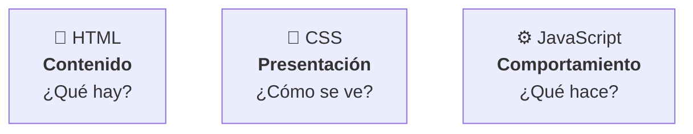
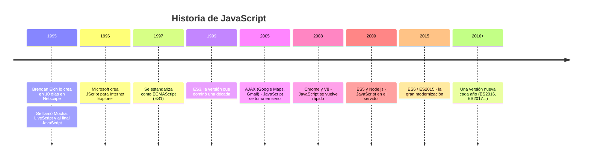
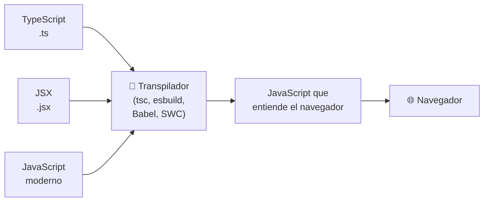
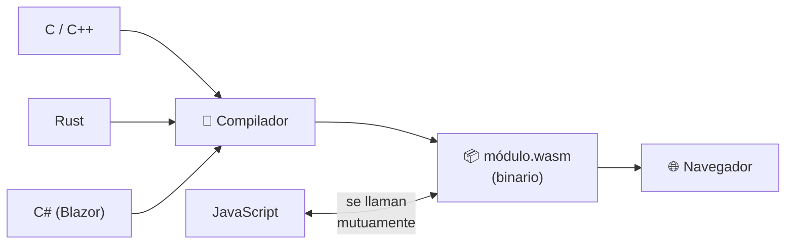
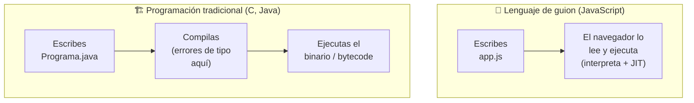

# 3. Lenguajes de programación en el cliente

[⬅️ Volver a la unidad](./README.md)

## Índice

- [3.1. Las tres capas de la web](#31-las-tres-capas-de-la-web)
- [3.2. JavaScript](#32-javascript)
  - [3.2.1. Un poco de historia](#321-un-poco-de-historia)
  - [3.2.2. ECMAScript: el estándar](#322-ecmascript-el-estándar)
  - [3.2.3. Características del lenguaje](#323-características-del-lenguaje)
- [3.3. Lenguajes que se convierten en JavaScript](#33-lenguajes-que-se-convierten-en-javascript)
  - [3.3.1. TypeScript](#331-typescript)
  - [3.3.2. Transpilación](#332-transpilación)
- [3.4. WebAssembly](#34-webassembly)
- [3.5. Tecnologías asociadas](#35-tecnologías-asociadas)
- [3.6. Lenguajes de guion frente a programación tradicional](#36-lenguajes-de-guion-frente-a-programación-tradicional)
  - [3.6.1. ¿Qué es un lenguaje de guion?](#361-qué-es-un-lenguaje-de-guion)
  - [3.6.2. Ventajas](#362-ventajas)
  - [3.6.3. Inconvenientes](#363-inconvenientes)
  - [3.6.4. Comparativa](#364-comparativa)
- [3.7. Ejemplo integrador: el mismo programa en tres lenguajes](#37-ejemplo-integrador-el-mismo-programa-en-tres-lenguajes)
- [3.8. Tecnologías del pasado](#38-tecnologías-del-pasado)
- [Resumen](#resumen)
- [Ejercicios de reflexión](#ejercicios-de-reflexión)

> **CE que trabaja este tema:** RA1 c, d.

---

## 3.1. Las tres capas de la web

Una página web en el cliente se construye con **tres lenguajes**, cada uno con una responsabilidad:



| Capa | Lenguaje | Tipo | Ejemplo |
|------|----------|------|---------|
| Contenido | HTML | Lenguaje de **marcas** | `<button>Comprar</button>` |
| Presentación | CSS | Lenguaje de **estilos** | `button { background: green; }` |
| Comportamiento | JavaScript | Lenguaje de **programación** | `boton.addEventListener('click', comprar)` |

HTML y CSS son **declarativos**: describen *qué* quieres, no *cómo* conseguirlo. No tienen variables de programa, bucles ni condiciones como tal. **JavaScript es el único de los tres que es un lenguaje de programación** completo. Junto con WebAssembly (apartado 3.4), es el único código que los navegadores ejecutan directamente.

> 📝 **Nota del Profesor**: Mantener estas tres capas **separadas** (cada una en su fichero) es un criterio de evaluación del módulo (RA6 h). Empieza a hacerlo desde hoy.

---

## 3.2. JavaScript

### 3.2.1. Un poco de historia

Esta línea de tiempo resume cómo nació el lenguaje y cómo ha ido cambiando:



Fíjate en el salto de 2015: tras años casi sin cambios, ES2015 modernizó el lenguaje y, desde entonces, sale una versión cada año.

A pesar del nombre, **JavaScript no tiene nada que ver con Java**. El nombre fue una decisión comercial de 1995 para aprovechar la fama de Java. Una comparación clásica: "Java es a JavaScript lo que coche es a alfombra".

### 3.2.2. ECMAScript: el estándar

**ECMAScript** es la especificación oficial del lenguaje, mantenida por el comité **TC39** de la organización **Ecma International**. **JavaScript** es la implementación de ese estándar que hacen los navegadores y Node.js.

- Desde 2015 sale **una versión cada año** y se nombran por año: ES2015 (también llamada ES6), ES2016… ES2025.
- Cada novedad pasa por varias **fases** (0, 1, 2, 2.7, 3 y 4) antes de entrar en el estándar. Cuando llega a la fase 4, se incluye en la siguiente versión anual.
- Los navegadores implementan las novedades poco a poco. Puedes consultar el soporte en <https://caniuse.com> o en las tablas de compatibilidad de MDN.

Algunas novedades importantes por versión:

| Versión | Novedades destacadas |
|---------|----------------------|
| ES5 (2009) | Modo estricto, `JSON`, `Array.prototype.forEach/map/filter` |
| **ES2015 (ES6)** | `let`/`const`, funciones flecha, clases, módulos, promesas, plantillas de texto, desestructuración, `Map`/`Set` |
| ES2017 | `async`/`await` |
| ES2020 | Operador `??`, encadenamiento opcional `?.`, `BigInt` |
| ES2022 | Campos privados en clases (`#`), `await` en el nivel superior de los módulos, `Array.prototype.at` |
| ES2023 | `toSorted`, `toReversed`, `with` (arrays sin mutar) |
| ES2024 | `Object.groupBy`, `Promise.withResolvers` |
| ES2025 | Métodos de `Set` (`union`, `intersection`…), iteradores con `map`/`filter` |

En este curso se usa **ES2025** como versión de referencia: la más reciente que funciona por completo en la versión LTS de Node.js y en los navegadores actuales. Lo verás con más detalle en la UD2.

> 💡 **Tip del Examinador**: "¿Qué diferencia hay entre JavaScript y ECMAScript?" → **ECMAScript es el estándar** (la especificación); **JavaScript es una implementación** de ese estándar, con las APIs que añade cada entorno (navegador, Node.js).

### 3.2.3. Características del lenguaje

| Característica | Qué significa | Ejemplo |
|----------------|---------------|---------|
| **Interpretado / JIT** | Se distribuye como código fuente; el motor lo ejecuta y optimiza al vuelo | Ver tema 2 |
| **Tipado dinámico** | Las variables no tienen tipo; los **valores** sí. Una variable puede cambiar de tipo | `let x = 5; x = 'hola';` ✅ |
| **Tipado débil** | Convierte tipos automáticamente al operar | `'5' * 2` → `10` |
| **Multiparadigma** | Admite estilo imperativo, orientado a objetos y funcional | Clases, `map`/`filter`, bucles |
| **Funciones de primera clase** | Las funciones son valores: se guardan en variables y se pasan como parámetros | `boton.addEventListener('click', manejar)` |
| **Orientado a objetos basado en prototipos** | Los objetos heredan de otros objetos; las clases son una sintaxis sobre los prototipos | UD3 |
| **Un solo hilo + eventos** | Un hilo principal y un bucle de eventos para la asincronía | Tema 2 y UD7 |

Pruébalo en la consola del navegador:

```js
let dato = 42;
console.log(typeof dato); // 'number'

dato = 'cuarenta y dos';
console.log(typeof dato); // 'string'  → tipado dinámico

console.log('5' * 2);     // 10        → tipado débil: convierte '5' en número
console.log('5' + 2);     // '52'      → ¡pero aquí concatena! (lo verás en la UD2)
```

> ⚠️ **Cuidado**: El tipado débil provoca resultados sorprendentes como `'5' + 2 === '52'`. En la UD2 aprenderás las reglas de conversión y a protegerte con `===` y conversiones explícitas.

---

## 3.3. Lenguajes que se convierten en JavaScript

Como el navegador solo entiende JavaScript (y WebAssembly), cualquier otro lenguaje que quiera ejecutarse en el cliente tiene que **traducirse** antes a JavaScript.

### 3.3.1. TypeScript

**TypeScript** (Microsoft, 2012) es un **superconjunto** de JavaScript: todo JavaScript válido es TypeScript válido, y TypeScript añade **tipos estáticos**.

```ts
// precio.ts — TypeScript
function calcularTotal(precio: number, cantidad: number): number {
  return precio * cantidad;
}

calcularTotal(9.99, 3);      // ✅ 29.97
calcularTotal('9.99', 3);    // ❌ Error al compilar:
// Argument of type 'string' is not assignable to parameter of type 'number'.
```

El error se detecta **mientras escribes**, en el editor, antes de ejecutar nada. Para que el navegador lo entienda, el compilador de TypeScript (`tsc`) o una herramienta como Vite **elimina los tipos** y genera JavaScript:

```js
// precio.js — lo que llega al navegador
function calcularTotal(precio, cantidad) {
  return precio * cantidad;
}
```

TypeScript es hoy el estándar en proyectos medianos y grandes, y es el lenguaje de **Angular** (UD8).

> 📝 **Nota del Profesor**: En este curso escribiremos **JavaScript** hasta la UD8, porque necesitas entender bien el lenguaje real que ejecuta el navegador. En la UD8 pasarás a TypeScript y verás que es "JavaScript con tipos". A cambio, desde la UD2 documentaremos los tipos con **JSDoc**, que el editor también entiende.

### 3.3.2. Transpilación

Traducir código de un lenguaje de alto nivel a otro de alto nivel se llama **transpilar** (*transpile*). Se usa para:

- Convertir **TypeScript** (u otros lenguajes) a JavaScript.
- Convertir **JavaScript moderno** a una versión más antigua para navegadores viejos.
- Convertir **JSX** (la sintaxis de React) a JavaScript.



Sea cual sea el lenguaje de partida, lo que llega al navegador es siempre JavaScript.

---

## 3.4. WebAssembly

**WebAssembly** (**Wasm**, estándar del W3C desde 2019) es un **formato binario** de bajo nivel que los navegadores ejecutan a una velocidad cercana a la nativa. No se escribe a mano: se **compila** desde lenguajes como C, C++, Rust, Go o C#.



- **No sustituye a JavaScript**: lo complementa. Wasm no puede tocar el DOM directamente; necesita a JavaScript como intermediario.
- Se usa para tareas de **cálculo intensivo**: edición de vídeo e imagen (Photoshop web), juegos, CAD (AutoCAD web, Figma), compresión, criptografía, o para llevar al navegador programas ya escritos en otros lenguajes.

Ejemplo de uso desde JavaScript de un módulo Wasm que exporta una función `sumar`:

```js
const { instance } = await WebAssembly.instantiateStreaming(fetch('calculos.wasm'));
console.log(instance.exports.sumar(2, 3)); // 5, calculado en WebAssembly
```

> 💡 **Tip del Examinador**: "¿WebAssembly va a sustituir a JavaScript?" → **No.** Wasm es para cálculo intensivo y reutilizar código de otros lenguajes; JavaScript sigue siendo el lenguaje para la interfaz y el DOM. Trabajan juntos.

---

## 3.5. Tecnologías asociadas

Además de HTML, CSS, JavaScript, TypeScript y WebAssembly, en el cliente conviven otros formatos y tecnologías que te encontrarás a lo largo del curso:

| Tecnología | Qué es | Dónde la verás |
|------------|--------|----------------|
| **JSON** | Formato de texto para intercambiar datos, basado en la sintaxis de objetos de JS | UD4, UD7 |
| **XML** | Lenguaje de marcas para datos, predecesor de JSON en muchas APIs | UD7 |
| **SVG** | Gráficos vectoriales descritos en XML, manipulables desde el DOM | UD5 |
| **HTTP/HTTPS** | Protocolo de comunicación cliente-servidor | Tema 1, UD7 |
| **Markdown** | Formato de texto para documentación (README) | Tema 5 |
| **Preprocesadores CSS** | Sass, Less: CSS con variables, anidamiento… (hoy CSS nativo ya tiene ambas cosas) | — |
| **JSX / plantillas** | Sintaxis para mezclar HTML y lógica en frameworks | UD8 (plantillas de Angular) |

---

## 3.6. Lenguajes de guion frente a programación tradicional

### 3.6.1. ¿Qué es un lenguaje de guion?

Un **lenguaje de guion** (*scripting language*) es un lenguaje pensado para **controlar o automatizar un programa anfitrión** (*host*), escribiendo pequeños programas llamados **guiones** o **scripts**. Suele ser interpretado y de tipado dinámico.

- JavaScript nació como lenguaje de guion para **controlar el navegador**: el anfitrión es el navegador, que le ofrece el DOM y las Web APIs.
- Otros ejemplos: **Bash** (controla el sistema operativo), **Python** (en muchos usos), **Lua** (videojuegos), **VBA** (Office), **PHP** (nació para incrustar lógica en páginas del servidor).

La **programación tradicional** (C, C++, Java, C#, Rust, Go) usa lenguajes **compilados** y, en general, de **tipado estático**, pensados para construir programas completos e independientes.



La diferencia clave es el paso de compilación: en la programación tradicional, los errores de tipo aparecen ahí, antes de ejecutar nada; en un lenguaje de guion, solo al ejecutar.

### 3.6.2. Ventajas

- ✅ **Ciclo de desarrollo rapidísimo**: guardas y recargas. No hay paso de compilación (o es instantáneo).
- ✅ **Curva de aprendizaje suave**: menos ceremonia, menos código para empezar.
- ✅ **Portabilidad**: el mismo script funciona en cualquier sistema con el anfitrión (cualquier navegador, en cualquier sistema operativo).
- ✅ **Flexibilidad**: el tipado dinámico permite prototipar muy rápido.
- ✅ **Integración con el anfitrión**: acceso directo a sus objetos (DOM, eventos).
- ✅ **Sin instalación** para el usuario: el código llega con la página.

### 3.6.3. Inconvenientes

- ❌ **Errores en tiempo de ejecución**: muchos errores (de tipo, de nombre) solo aparecen al ejecutar esa línea, a veces delante del usuario.
- ❌ **Rendimiento** tradicionalmente menor (muy mejorado con JIT, pero sin llegar a lo nativo en cálculo intensivo).
- ❌ **Código visible**: el código fuente llega al cliente; cualquiera puede leerlo (se puede *minificar*, pero no ocultar).
- ❌ **Dependencia del anfitrión**: diferencias entre navegadores, versiones antiguas, usuarios con JavaScript desactivado.
- ❌ **Mantenibilidad** en proyectos grandes: sin tipos, refactorizar es más arriesgado (por eso existe TypeScript).

### 3.6.4. Comparativa

| Aspecto | Lenguaje de guion (JavaScript) | Programación tradicional (Java, C#) |
|---------|--------------------------------|-------------------------------------|
| Ejecución | Interpretado + JIT | Compilado (a código máquina o bytecode) |
| Tipado | Dinámico y débil | Estático y fuerte |
| Cuándo se detectan errores de tipo | Al ejecutar | Al compilar |
| Velocidad de desarrollo | Muy alta | Media |
| Rendimiento | Bueno (JIT) | Muy bueno |
| Distribución | Código fuente | Binario o bytecode |
| Depende de | Un anfitrión (navegador) | Sistema operativo o máquina virtual |
| Uso típico | Interfaces, automatización, prototipos | Aplicaciones grandes, sistemas, alto rendimiento |

> 💡 **Tip del Examinador**: Si te piden "ventajas e inconvenientes de la programación de guiones", organiza la respuesta en dos columnas y da al menos tres de cada: rapidez de desarrollo, portabilidad y sencillez frente a errores en ejecución, menor rendimiento y código visible.

---

## 3.7. Ejemplo integrador: el mismo programa en tres lenguajes

Programa: calcular la media de una lista de notas y decir si aprueba.

**JavaScript** (guion, tipado dinámico):

```js
// media.js — se ejecuta directamente: node media.js (o en el navegador)
function media(notas) {
  const suma = notas.reduce((total, nota) => total + nota, 0);
  return suma / notas.length;
}

const notas = [7, 5.5, 8, 4];
const resultado = media(notas);
console.log(`Media: ${resultado.toFixed(2)} → ${resultado >= 5 ? '✅ Aprobado' : '❌ Suspenso'}`);

// Salida:
// Media: 6.13 → ✅ Aprobado

console.log(media(['7', '5'])); // 37.5 😱 ¡No avisa del error de tipo!
```

**TypeScript** (JavaScript + tipos, se transpila):

```ts
// media.ts
function media(notas: number[]): number {
  const suma = notas.reduce((total, nota) => total + nota, 0);
  return suma / notas.length;
}

media(['7', '5']);
// ❌ Error en el editor: Type 'string' is not assignable to type 'number'.
```

**Java** (programación tradicional, compilado):

```java
// Media.java — javac Media.java && java Media
import java.util.List;

public class Media {
    static double media(List<Double> notas) {
        double suma = 0;
        for (double nota : notas) suma += nota;
        return suma / notas.size();
    }

    public static void main(String[] args) {
        double resultado = media(List.of(7.0, 5.5, 8.0, 4.0));
        System.out.printf("Media: %.2f%n", resultado);

        // media(List.of("7", "5"));
        // ❌ javac no compila: una lista de textos no es una List<Double>
    }
}
```

Observa:

- JavaScript es el **más corto** y se ejecuta sin compilar, pero acepta `['7', '5']` y da un resultado absurdo (`0 + '7'` da `'07'`, después `'075'`, y `'075' / 2` da `37.5`) **sin avisar**.
- TypeScript mantiene la sintaxis de JavaScript y **detecta el error antes de ejecutar**.
- Java necesita más código (clase, `main`, tipos) y un paso de compilación, pero la llamada con textos ni siquiera compila: el error no llega a ejecutarse.

---

## 3.8. Tecnologías del pasado

Conviene conocerlas para entender textos antiguos y por qué hoy solo queda JavaScript en el cliente:

| Tecnología | Época | Qué era | Por qué desapareció |
|------------|-------|---------|---------------------|
| **Applets de Java** | 1995–2015 | Programas Java incrustados en la página | Lentos, problemas de seguridad, necesitaban un plugin |
| **ActiveX** | 1996–2015 | Componentes de Windows en Internet Explorer | Solo Windows e IE, graves problemas de seguridad |
| **VBScript** | 1996–2019 | Alternativa de Microsoft a JavaScript | Solo funcionaba en Internet Explorer |
| **Flash** (ActionScript) | 1996–2020 | Animaciones, juegos y vídeo mediante un plugin | Seguridad, rendimiento en móviles, llegada de HTML5 |
| **Silverlight** | 2007–2021 | Alternativa de Microsoft a Flash | Mismos motivos que Flash |

La lección: **las tecnologías que necesitaban plugins propietarios han desaparecido**. Los estándares abiertos (HTML, CSS, JavaScript, WebAssembly) son los que perduran.

---

## Resumen

- Una página web tiene tres capas: **HTML** (contenido), **CSS** (presentación) y **JavaScript** (comportamiento). Solo JavaScript es un lenguaje de programación.
- **ECMAScript** es el estándar; **JavaScript** su implementación. Hay una versión nueva cada año desde ES2015.
- JavaScript es **interpretado/JIT**, de **tipado dinámico y débil**, **multiparadigma** y con **funciones de primera clase**.
- **TypeScript** añade tipos estáticos a JavaScript y se **transpila** a JavaScript.
- **WebAssembly** es un formato binario para cálculo intensivo; complementa a JavaScript, no lo sustituye.
- Los **lenguajes de guion** ganan en rapidez de desarrollo, portabilidad y sencillez; pierden en detección temprana de errores, rendimiento y privacidad del código.

> 📝 **Nota del Profesor**: A partir de la UD2 aprenderás JavaScript en serio. Ten presente la tabla de ventajas e inconvenientes: muchas de las buenas prácticas que verás (usar `===`, JSDoc, tests, ESLint) existen precisamente para compensar los inconvenientes de un lenguaje de guion.

## Ejercicios de reflexión

1. Busca en <https://caniuse.com> una característica de alguna de las dos últimas versiones de ECMAScript. ¿Qué navegadores la soportan ya?
2. ¿Por qué crees que TypeScript se ha hecho tan popular si al final se convierte en JavaScript?
3. Busca un ejemplo real de aplicación web que use WebAssembly y explica qué parte hace con Wasm y por qué.
4. Piensa en un programa que harías con un lenguaje de guion y otro que harías con un lenguaje compilado tradicional. Justifícalo.
5. Ejecuta en la consola `[] + []`, `[] + {}` y `'3' - 1`. ¿Te parece una ventaja o un inconveniente del tipado débil?

---

[⬅️ Volver a la unidad](./README.md)
