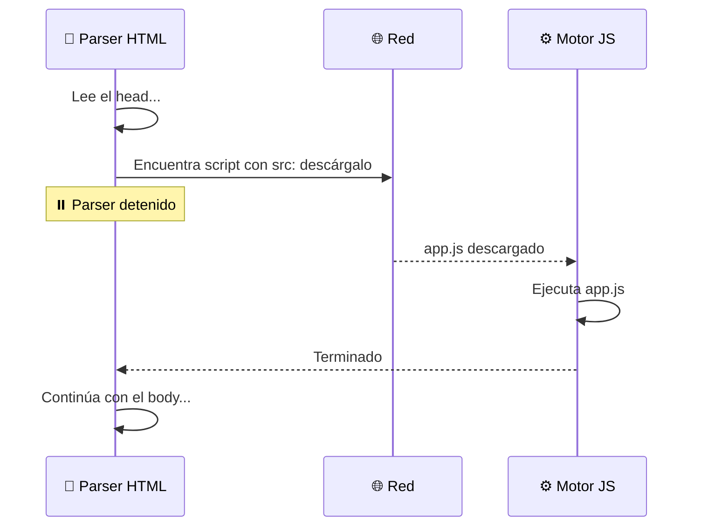
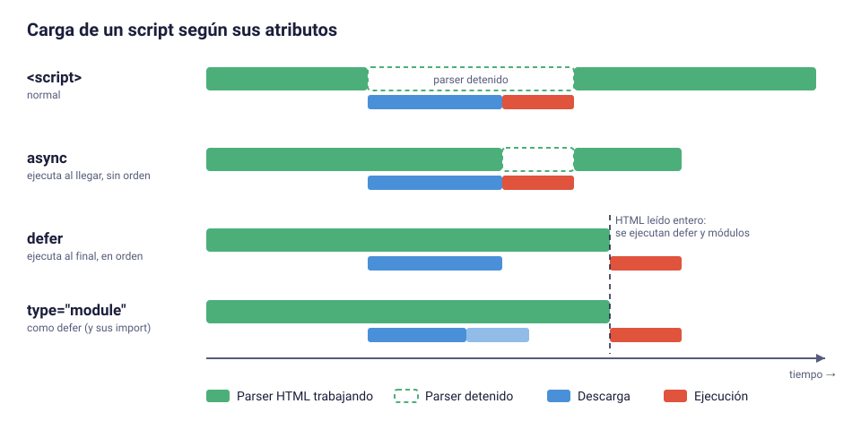
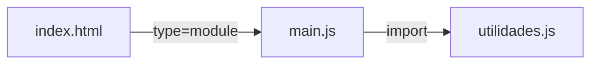
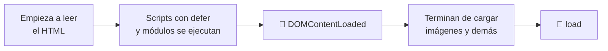

# 4. Integración de JavaScript con HTML

[⬅️ Volver a la unidad](./README.md)

## Índice

- [4.1. La etiqueta `<script>`](#41-la-etiqueta-script)
  - [4.1.1. Script en línea](#411-script-en-línea)
  - [4.1.2. Script externo](#412-script-externo)
- [4.2. El problema: los scripts bloquean](#42-el-problema-los-scripts-bloquean)
- [4.3. Dónde colocar el script](#43-dónde-colocar-el-script)
- [4.4. Los atributos `defer` y `async`](#44-los-atributos-defer-y-async)
  - [4.4.1. `defer`](#441-defer)
  - [4.4.2. `async`](#442-async)
  - [4.4.3. Comparativa visual](#443-comparativa-visual)
- [4.5. Módulos: `type="module"`](#45-módulos-typemodule)
  - [4.5.1. Qué cambia con un módulo](#451-qué-cambia-con-un-módulo)
  - [4.5.2. `import` y `export`](#452-import-y-export)
  - [4.5.3. Los módulos necesitan un servidor](#453-los-módulos-necesitan-un-servidor)
- [4.6. Esperar al DOM: `DOMContentLoaded` y `load`](#46-esperar-al-dom-domcontentloaded-y-load)
- [4.7. `<noscript>`](#47-noscript)
- [4.8. Código JavaScript en atributos HTML: por qué no](#48-código-javascript-en-atributos-html-por-qué-no)
- [4.9. Ejemplo integrador: comprobar el orden de ejecución](#49-ejemplo-integrador-comprobar-el-orden-de-ejecución)
- [Resumen](#resumen)
- [Ejercicios de reflexión](#ejercicios-de-reflexión)

> **CE que trabaja este tema:** RA1 e.

---

## 4.1. La etiqueta `<script>`

HTML es el lenguaje de marcas; JavaScript, el de programación. La etiqueta `<script>` es el **punto de unión** entre ambos: le dice al navegador "aquí hay código que debes ejecutar".

### 4.1.1. Script en línea

El código va **dentro** de la etiqueta:

```html
<!doctype html>
<html lang="es">
  <head>
    <meta charset="utf-8" />
    <title>Script en línea</title>
  </head>
  <body>
    <h1>Hola</h1>
    <script>
      console.log('Hola desde un script en línea');
    </script>
  </body>
</html>
```

Útil para pruebas rápidas, pero **mezcla contenido y comportamiento**, no se puede reutilizar en otras páginas y el navegador no lo puede guardar en caché por separado.

### 4.1.2. Script externo

El código va en un fichero `.js` aparte y se enlaza con el atributo `src`:

```html
<script src="js/app.js"></script>
```

```js
// js/app.js
console.log('Hola desde un fichero externo');
```

| | Script en línea | Script externo |
|---|---|---|
| Separación de capas | ❌ Mezcla HTML y JS | ✅ Cada cosa en su fichero |
| Reutilización | ❌ Solo en esa página | ✅ Varias páginas pueden usarlo |
| Caché del navegador | ❌ Se descarga con el HTML cada vez | ✅ Se descarga una vez y se guarda |
| Petición extra | ✅ No | ❌ Sí (una por fichero) |

> ⚠️ **Cuidado**: Si una etiqueta `<script>` tiene `src`, **el código que pongas dentro se ignora**. Y la etiqueta **siempre necesita cierre** `</script>`: `<script src="app.js" />` no funciona como esperas.

> ✅ **Buena práctica**: Usa siempre **scripts externos**. El script en línea déjalo para experimentos.

---

## 4.2. El problema: los scripts bloquean

Recuerda del tema 2 que el navegador construye el DOM leyendo el HTML de arriba abajo. Cuando encuentra un `<script>` **normal** (sin atributos especiales), **se detiene**:

1. Para de construir el DOM (*parsing*).
2. Descarga el script (si es externo).
3. Lo ejecuta.
4. Y solo entonces continúa leyendo el HTML.

¿Por qué? Porque el script podría modificar el documento que se está leyendo (históricamente, con `document.write`), así que el navegador espera a ver qué hace.



Esto provoca **dos problemas**:

1. **La página tarda más en mostrarse**: mientras se descarga el script, el usuario ve una pantalla en blanco.
2. **El script no encuentra los elementos** que están por debajo de él, porque aún no existen en el DOM.

El segundo es el error más típico de principiante:

```html
<head>
  <script src="app.js"></script>
</head>
<body>
  <button id="saludar">Saludar</button>
</body>
```

```js
// app.js
const boton = document.querySelector('#saludar');
console.log(boton);  // null 😱 el botón todavía no existe
boton.addEventListener('click', () => alert('Hola'));
// ❌ TypeError: Cannot read properties of null (reading 'addEventListener')
```

---

## 4.3. Dónde colocar el script

La solución clásica fue poner los scripts **al final del `<body>`**, justo antes de `</body>`:

```html
<body>
  <button id="saludar">Saludar</button>

  <!-- Al final: el DOM de arriba ya existe -->
  <script src="app.js"></script>
</body>
```

Funciona: cuando se ejecuta el script, el botón ya está en el DOM, y la página se muestra antes. Pero tiene un inconveniente: el navegador **no empieza a descargar** el script hasta que llega al final del HTML. En páginas largas, eso es tiempo perdido.

La solución moderna es dejar el script en el `<head>` (se descubre pronto y se descarga cuanto antes) pero decirle al navegador que **no bloquee**. Para eso existen `defer`, `async` y `type="module"`.

---

## 4.4. Los atributos `defer` y `async`

Ambos solo tienen efecto en **scripts externos** (con `src`). Los dos hacen que el script se **descargue en paralelo** mientras el parser sigue leyendo el HTML. La diferencia está en **cuándo se ejecuta**.

### 4.4.1. `defer`

```html
<head>
  <script src="app.js" defer></script>
</head>
```

- Se descarga en paralelo sin detener el parser.
- Se ejecuta **cuando el HTML se ha leído entero** (el DOM está completo), justo antes del evento `DOMContentLoaded`.
- Si hay varios scripts con `defer`, se ejecutan **en el orden en que aparecen** en el HTML.

Es la opción ideal para el código de tu aplicación: se descarga pronto, no bloquea y, cuando se ejecuta, **todos los elementos existen**.

### 4.4.2. `async`

```html
<head>
  <script src="analitica.js" async></script>
</head>
```

- Se descarga en paralelo sin detener el parser.
- Se ejecuta **en cuanto termina de descargarse**, interrumpiendo el parser en ese momento.
- Si hay varios scripts con `async`, se ejecutan **en el orden en que terminen de descargarse** (impredecible).

Útil para scripts **independientes**, que no dependen del DOM ni de otros scripts: analítica, publicidad, widgets de terceros.

### 4.4.3. Comparativa visual



- **Normal**: el parser se para durante la descarga **y** la ejecución.
- **`async`**: el parser solo se para durante la **ejecución**, que ocurre en cuanto termina la descarga.
- **`defer`**: el parser **nunca** se para; el script se ejecuta al final.

| | Normal | `async` | `defer` | `type="module"` |
|---|---|---|---|---|
| Bloquea al descargar | ✅ Sí | ❌ No | ❌ No | ❌ No |
| Cuándo se ejecuta | Al llegar a él | Al terminar la descarga | Con el DOM completo | Con el DOM completo (como `defer`) |
| Respeta el orden | ✅ Sí | ❌ No | ✅ Sí | ✅ Sí |
| ¿El DOM está listo? | Solo lo de arriba | No garantizado | ✅ Sí | ✅ Sí |
| Uso típico | Código heredado | Analítica, anuncios | Código de la aplicación | Código de la aplicación con módulos |

> 💡 **Tip del Examinador**: Pregunta clásica: "¿Diferencia entre `async` y `defer`?" → Ambos descargan sin bloquear. **`defer` ejecuta al final y en orden**; **`async` ejecuta en cuanto se descarga y sin orden garantizado**.

---

## 4.5. Módulos: `type="module"`

Desde ES2015, JavaScript tiene un sistema de **módulos** nativo: cada fichero puede **exportar** funciones, clases o valores e **importar** los de otros ficheros. Para que el navegador trate un script como módulo, se usa `type="module"`:

```html
<script type="module" src="js/main.js"></script>
```

### 4.5.1. Qué cambia con un módulo

| Característica | Script clásico | Módulo |
|----------------|----------------|--------|
| Carga | Bloquea (salvo `defer`/`async`) | **Diferida por defecto** (como `defer`) |
| Ámbito de las variables | Global: comparten `window` | **Propio del módulo**: no contaminan el global |
| Modo estricto | Opcional (`'use strict'`) | **Siempre activo** |
| `import` / `export` | ❌ No | ✅ Sí |
| `await` en el nivel superior | ❌ No | ✅ Sí |
| Se ejecuta… | Cada vez que aparece | **Una sola vez**, aunque se importe varias veces |
| Funciona con `file://` | ✅ Sí | ❌ **No**: necesita un servidor |

### 4.5.2. `import` y `export`

```text
proyecto/
├── index.html
└── js/
    ├── main.js
    └── utilidades.js
```

```js
// js/utilidades.js
export function formatearPrecio(importe) {
  return importe.toLocaleString('es-ES', { style: 'currency', currency: 'EUR' });
}

export const IVA = 0.21;
```

```js
// js/main.js
import { formatearPrecio, IVA } from './utilidades.js';

const precioBase = 100;
const precioFinal = precioBase * (1 + IVA);
document.querySelector('#precio').textContent = formatearPrecio(precioFinal);
// Muestra: 121,00 €
```

```html
<!-- index.html -->
<head>
  <script type="module" src="js/main.js"></script>
</head>
<body>
  <p>Total: <span id="precio"></span></p>
</body>
```



Fíjate en que solo `main.js` aparece en el HTML: el navegador descubre y descarga `utilidades.js` al leer el `import`. En la UD3 estudiarás los módulos a fondo.

> ⚠️ **Cuidado**: En el navegador, la ruta del `import` debe ser **completa, con extensión**: `'./utilidades.js'`. Escribir `'./utilidades'` funciona con herramientas como Vite, pero no directamente en el navegador.

### 4.5.3. Los módulos necesitan un servidor

Si abres el `index.html` anterior con doble clic (la URL empieza por `file://`), la consola mostrará un error parecido a este:

```text
Access to script at 'file:///home/alumno/proyecto/js/main.js' from origin 'null'
has been blocked by CORS policy
```

Los módulos se cargan aplicando la **política del mismo origen** (tema 2), y los ficheros locales no tienen un origen válido. La solución es servir la carpeta con un **servidor de desarrollo**:

- La extensión **Live Server** de VS Code (botón *Go Live*).
- `npx serve` o `npx http-server` desde la terminal.
- **Vite** (`npm run dev`), que usarás a partir del tema 5.

> 📝 **Nota del Profesor**: Desde la UD2 trabajaremos siempre con `type="module"` y un servidor de desarrollo. Así tu código estará aislado, en modo estricto, se ejecutará con el DOM listo y podrás organizarlo en varios ficheros.

---

## 4.6. Esperar al DOM: `DOMContentLoaded` y `load`

Si por algún motivo tu script se ejecuta antes de que el DOM esté listo (script clásico en el `<head>` sin `defer`), puedes decirle que espere a un **evento** del documento:

| Evento | Se dispara cuando… |
|--------|--------------------|
| `DOMContentLoaded` (en `document`) | El HTML se ha leído entero y el DOM está construido. No espera a imágenes ni hojas de estilo. |
| `load` (en `window`) | La página se ha cargado **por completo**, incluidas imágenes, estilos, iframes… |

```js
document.addEventListener('DOMContentLoaded', () => {
  // Aquí el DOM ya está completo
  const boton = document.querySelector('#saludar');
  boton.addEventListener('click', () => alert('Hola'));
});
```

Este es el orden en que ocurre todo durante la carga de la página:



Con `defer` o `type="module"` **no necesitas** `DOMContentLoaded`, porque el script ya se ejecuta con el DOM completo. Lo verás en código antiguo, y en la UD6 estudiarás los eventos en detalle.

---

## 4.7. `<noscript>`

El contenido de `<noscript>` solo se muestra si el navegador **tiene JavaScript desactivado**:

```html
<noscript>
  <p class="aviso">⚠️ Esta aplicación necesita JavaScript. Actívalo en tu navegador para continuar.</p>
</noscript>
```

Es especialmente importante en las SPA (tema 1), donde sin JavaScript el usuario vería una página completamente en blanco.

---

## 4.8. Código JavaScript en atributos HTML: por qué no

HTML permite escribir código directamente en **atributos de evento** (`onclick`, `onload`, `onsubmit`…) o en enlaces con `javascript:`:

```html
<!-- ❌ Mala práctica -->
<button onclick="alert('Hola')">Saludar</button>
<a href="javascript:borrarTodo()">Borrar</a>
<body onload="iniciar()">
```

Lo verás en muchos tutoriales antiguos, pero **no debes usarlo**:

- ❌ **Mezcla capas**: el comportamiento queda repartido por el HTML.
- ❌ Solo permite **un manejador por evento** y elemento.
- ❌ Obliga a que las funciones sean **globales** (no funciona con módulos).
- ❌ Es difícil de mantener y de depurar.
- ❌ Las políticas de seguridad modernas (**CSP**, *Content Security Policy*) suelen **prohibirlo** porque se parece a los ataques de inyección de código (XSS).

La forma correcta es dejar el HTML limpio y enganchar el comportamiento **desde el fichero JavaScript**:

```html
<!-- ✅ HTML limpio: solo contenido -->
<button id="saludar">Saludar</button>
```

```js
// ✅ app.js: el comportamiento, en su capa
document.querySelector('#saludar').addEventListener('click', () => {
  alert('Hola');
});
```

> 💡 **Tip del Examinador**: Si en un ejercicio o examen escribes `onclick="..."` en el HTML, se considerará que **no has separado las capas** (RA6 h). Usa siempre `addEventListener` desde el JavaScript.

---

## 4.9. Ejemplo integrador: comprobar el orden de ejecución

Esta página carga cinco scripts de formas distintas. Cada uno escribe un mensaje en la consola. Antes de ejecutarla, **intenta predecir el orden**.

```text
orden-scripts/
├── index.html
└── js/
    ├── normal.js
    ├── defer1.js
    ├── defer2.js
    ├── async.js
    └── modulo.js
```

```html
<!-- index.html -->
<!doctype html>
<html lang="es">
  <head>
    <meta charset="utf-8" />
    <title>Orden de ejecución de scripts</title>
    <script src="js/defer1.js" defer></script>
    <script type="module" src="js/modulo.js"></script>
    <script src="js/async.js" async></script>
    <script src="js/defer2.js" defer></script>
    <script src="js/normal.js"></script>
    <script>
      document.addEventListener('DOMContentLoaded', () => console.log('🔔 DOMContentLoaded'));
      window.addEventListener('load', () => console.log('🔔 load'));
    </script>
  </head>
  <body>
    <h1 id="titulo">Orden de ejecución</h1>
  </body>
</html>
```

Cada fichero contiene una línea parecida a esta (cambiando el nombre):

```js
// js/defer1.js
console.log('defer1 → ¿existe el título?', document.querySelector('#titulo') !== null);
```

Sírvelo con un servidor (por el módulo) y abre la consola. Este es un resultado real obtenido en Chrome:

```text
normal → ¿existe el título? false
defer1 → ¿existe el título? true
modulo → ¿existe el título? true
defer2 → ¿existe el título? true
🔔 DOMContentLoaded
async → ¿existe el título? true      ← su posición puede cambiar en cada recarga
🔔 load
```

Conclusiones:

1. `normal.js` se ejecuta **al instante** y no ve el `<h1>`, que aún no existe.
2. `async.js` se ejecuta **cuando termina su descarga**, así que su posición puede variar entre recargas: entre los scripts diferidos o incluso **después** de `DOMContentLoaded`. Si terminara de descargarse mientras el parser espera a `normal.js`, podría ejecutarse incluso antes que él. Ese evento **no espera** a los scripts `async`.
3. `defer1.js`, `modulo.js` y `defer2.js` se ejecutan **después de leer todo el HTML** y **en el orden en que aparecen**. Todos ven el `<h1>`.
4. `DOMContentLoaded` llega después de los scripts diferidos; `load`, al final de todo.

En la pestaña **Rendimiento** de las DevTools puedes grabar la carga y ver gráficamente cuándo se descarga y se ejecuta cada script.

---

## Resumen

- `<script>` une HTML y JavaScript. Usa **scripts externos** (`src`) para separar capas y aprovechar la caché.
- Un script normal **bloquea** la construcción del DOM y no ve los elementos que están por debajo.
- **`defer`**: descarga en paralelo y ejecuta al final, en orden. **`async`**: descarga en paralelo y ejecuta en cuanto llega, sin orden.
- **`type="module"`**: diferido por defecto, ámbito propio, modo estricto, permite `import`/`export`. **Necesita un servidor**.
- `DOMContentLoaded` avisa de que el DOM está listo; `load`, de que la página ha terminado de cargar entera.
- `<noscript>` muestra contenido alternativo sin JavaScript.
- **Nunca** escribas JavaScript en atributos HTML (`onclick`…): usa `addEventListener` desde el fichero JS.

> 📝 **Nota del Profesor**: La receta que usarás en todo el curso es: **`<script type="module" src="js/main.js"></script>` en el `<head>`** y un servidor de desarrollo. Con eso tienes carga sin bloqueo, DOM listo, módulos y modo estricto.

## Ejercicios de reflexión

1. ¿Por qué `async` no es buena idea para el código principal de tu aplicación?
2. Tienes dos scripts: `libreria.js` y `app.js`, que usa funciones de la librería. ¿Qué atributos usarías y en qué orden los pondrías? ¿Y si fueran módulos?
3. Abre el código fuente de una web conocida y busca sus etiquetas `<script>`. ¿Usan `defer`, `async` o `type="module"`? ¿Dónde están colocadas?
4. ¿Qué ventajas tiene que las variables de un módulo no sean globales?

---

[⬅️ Volver a la unidad](./README.md)
