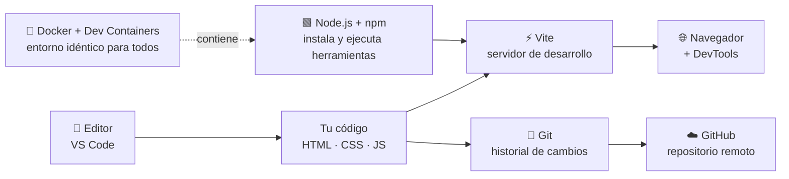
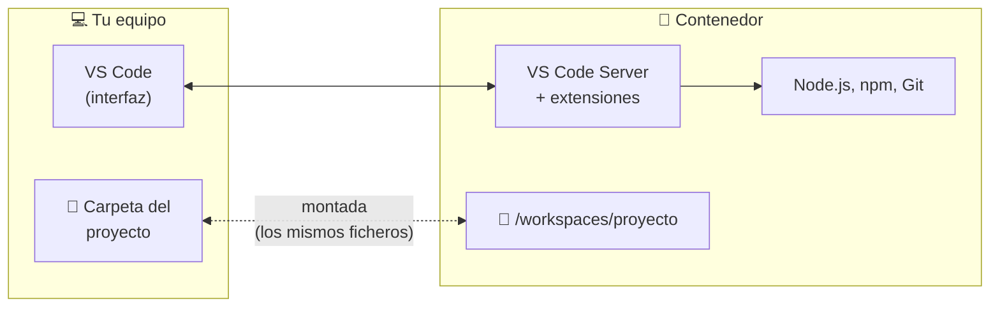
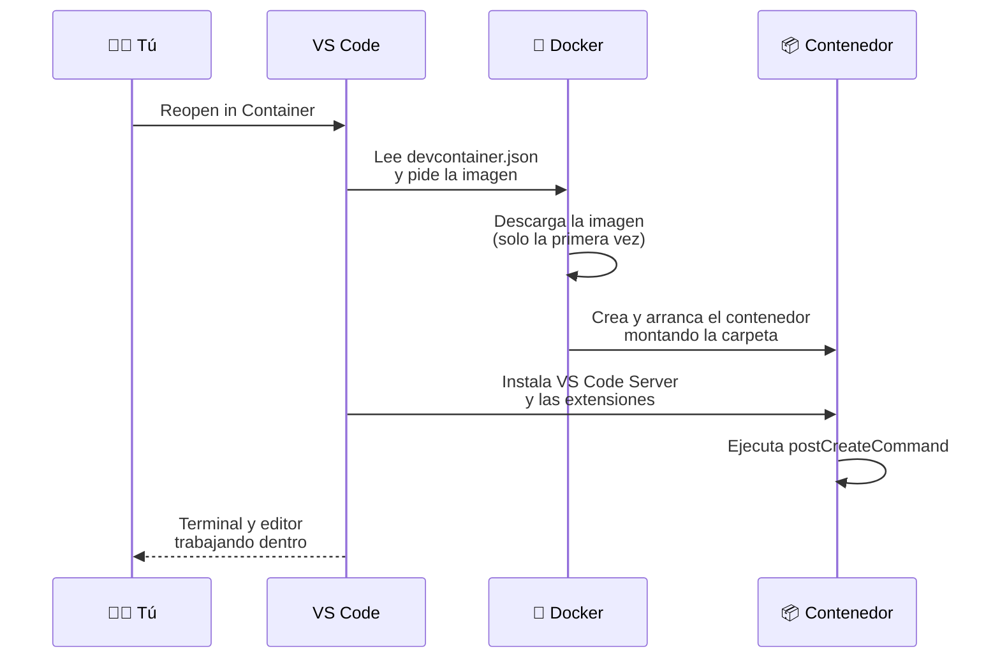
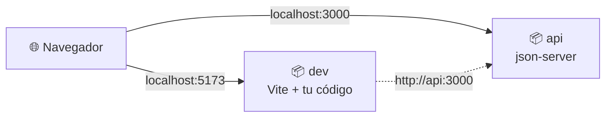
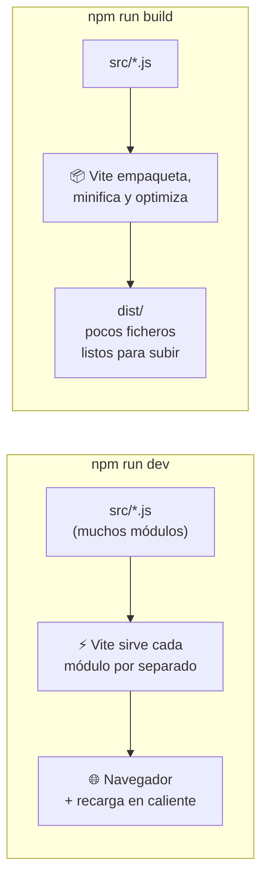
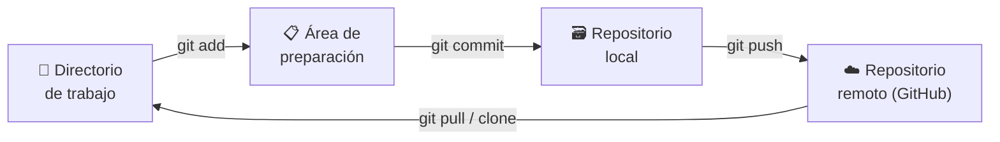

# 5. El entorno de desarrollo

[⬅️ Volver a la unidad](./README.md)

## Índice

- [5.1. ¿Qué necesitas para programar en el cliente?](#51-qué-necesitas-para-programar-en-el-cliente)
- [5.2. Visual Studio Code](#52-visual-studio-code)
  - [5.2.1. Extensiones recomendadas](#521-extensiones-recomendadas)
  - [5.2.2. Configuración compartida del proyecto](#522-configuración-compartida-del-proyecto)
- [5.3. Node.js y npm](#53-nodejs-y-npm)
  - [5.3.1. ¿Por qué Node.js si programamos para el navegador?](#531-por-qué-nodejs-si-programamos-para-el-navegador)
  - [5.3.2. `package.json`](#532-packagejson)
  - [5.3.3. Dependencias](#533-dependencias)
  - [5.3.4. Scripts de npm y `npx`](#534-scripts-de-npm-y-npx)
- [5.4. Dev Containers: el mismo entorno para todos](#54-dev-containers-el-mismo-entorno-para-todos)
  - [5.4.1. El problema: "en mi ordenador funciona"](#541-el-problema-en-mi-ordenador-funciona)
  - [5.4.2. Qué es un Dev Container](#542-qué-es-un-dev-container)
  - [5.4.3. Requisitos](#543-requisitos)
  - [5.4.4. Tu primer Dev Container para JavaScript](#544-tu-primer-dev-container-para-javascript)
  - [5.4.5. Qué ocurre al abrirlo](#545-qué-ocurre-al-abrirlo)
  - [5.4.6. Extensiones: cliente y servidor](#546-extensiones-cliente-y-servidor)
  - [5.4.7. Detener y limpiar contenedores](#547-detener-y-limpiar-contenedores)
  - [5.4.8. Varios contenedores con Docker Compose](#548-varios-contenedores-con-docker-compose)
- [5.5. Vite: servidor de desarrollo y empaquetador](#55-vite-servidor-de-desarrollo-y-empaquetador)
  - [5.5.1. Crear un proyecto](#551-crear-un-proyecto)
  - [5.5.2. Desarrollo y recarga en caliente](#552-desarrollo-y-recarga-en-caliente)
  - [5.5.3. Construir para producción](#553-construir-para-producción)
- [5.6. Git y GitHub](#56-git-y-github)
  - [5.6.1. Conceptos básicos](#561-conceptos-básicos)
  - [5.6.2. Flujo de trabajo para entregar prácticas](#562-flujo-de-trabajo-para-entregar-prácticas)
  - [5.6.3. `.gitignore`](#563-gitignore)
- [5.7. Documentar el proyecto: el README](#57-documentar-el-proyecto-el-readme)
- [5.8. Ejemplo integrador: la plantilla de proyecto del curso](#58-ejemplo-integrador-la-plantilla-de-proyecto-del-curso)
- [Resumen](#resumen)
- [Ejercicios de reflexión](#ejercicios-de-reflexión)

> **CE que trabaja este tema:** RA1 f.

---

## 5.1. ¿Qué necesitas para programar en el cliente?

Para escribir una página con JavaScript bastaría un editor de texto y un navegador. Pero en un entorno profesional se usan más herramientas, cada una con su función:



| Herramienta | Para qué sirve |
|-------------|----------------|
| **Visual Studio Code** | Editor de código con extensiones |
| **Navegador + DevTools** | Ejecutar, inspeccionar y depurar (Chrome o Firefox; mejor ambos) |
| **Node.js + npm** | Ejecutar JavaScript fuera del navegador e instalar herramientas de desarrollo |
| **Vite** | Servidor de desarrollo con recarga automática y empaquetado para producción |
| **Git + GitHub** | Control de versiones y entrega de prácticas |
| **Docker + Dev Containers** | Tener exactamente el mismo entorno en clase y en casa |
| **ESLint, Prettier, Vitest** | Calidad, formato y pruebas del código (tema 6) |

---

## 5.2. Visual Studio Code

**Visual Studio Code** (VS Code) es un editor gratuito y de código abierto de Microsoft, el más usado en desarrollo web. Descárgalo en <https://code.visualstudio.com>.

Atajos que debes conocer desde el primer día:

| Atajo | Acción |
|-------|--------|
| `Ctrl+Mayús+P` (o `F1`) | Paleta de comandos: desde aquí se hace **todo** |
| `Ctrl+P` | Abrir un fichero por su nombre |
| `` Ctrl+` `` | Abrir o cerrar el terminal integrado |
| `Ctrl+B` | Mostrar u ocultar la barra lateral |
| `Alt+Mayús+F` | Formatear el documento |
| `F2` | Renombrar un símbolo en todo el proyecto |
| `Ctrl+D` | Seleccionar la siguiente coincidencia (edición múltiple) |
| `F12` | Ir a la definición |

### 5.2.1. Extensiones recomendadas

| Extensión | Identificador | Para qué |
|-----------|---------------|----------|
| Dev Containers | `ms-vscode-remote.remote-containers` | Trabajar dentro de un contenedor (5.4) |
| ESLint | `dbaeumer.vscode-eslint` | Marca errores y malas prácticas mientras escribes |
| Prettier | `esbenp.prettier-vscode` | Formatea el código automáticamente |
| Vitest | `vitest.explorer` | Ejecuta y muestra los tests desde el editor |
| Error Lens | `usernamehw.errorlens` | Muestra los errores en la misma línea |
| GitLens | `eamodio.gitlens` | Historial de Git línea a línea |
| Markdown Preview Mermaid Support | `bierner.markdown-mermaid` | Ver los diagramas Mermaid en la vista previa de Markdown |
| Live Server | `ritwickdey.liveserver` | Servidor rápido para páginas sueltas sin Vite |

### 5.2.2. Configuración compartida del proyecto

Las preferencias de VS Code se pueden guardar **dentro del proyecto**, en `.vscode/settings.json`, para que todo el equipo trabaje igual:

```json
{
  "editor.formatOnSave": true,
  "editor.defaultFormatter": "esbenp.prettier-vscode",
  "editor.codeActionsOnSave": {
    "source.fixAll.eslint": "explicit"
  },
  "files.eol": "\n"
}
```

Con esto, cada vez que guardes un fichero se formateará con Prettier y se corregirán los errores automáticos de ESLint.

---

## 5.3. Node.js y npm

### 5.3.1. ¿Por qué Node.js si programamos para el navegador?

Tu aplicación se ejecutará en el navegador, pero **las herramientas** que usas para desarrollarla (Vite, ESLint, Prettier, Vitest…) están escritas en JavaScript y se ejecutan con **Node.js** en tu equipo.

- **Node.js**: entorno para ejecutar JavaScript fuera del navegador, construido sobre el motor V8 (tema 2).
- **npm** (*Node Package Manager*): gestor de paquetes que viene con Node.js. Descarga librerías y herramientas del registro público <https://www.npmjs.com>.

```bash
node --version   # v24.x.x (usa siempre la versión LTS vigente)
npm --version    # 11.x.x
```

> 📝 **Nota del Profesor**: Si trabajas con el Dev Container del curso (5.4) **no necesitas instalar Node.js** en tu equipo: ya viene dentro del contenedor.

### 5.3.2. `package.json`

Cada proyecto tiene un fichero `package.json` en su raíz que lo describe: nombre, versión, dependencias y scripts. Se crea con:

```bash
npm init -y
```

Un `package.json` típico de este curso:

```json
{
  "name": "mi-proyecto",
  "version": "1.0.0",
  "type": "module",
  "scripts": {
    "dev": "vite",
    "build": "vite build",
    "preview": "vite preview",
    "test": "vitest",
    "lint": "eslint .",
    "format": "prettier --write ."
  },
  "devDependencies": {
    "eslint": "^10.0.0",
    "prettier": "^3.0.0",
    "vite": "^8.0.0",
    "vitest": "^5.0.0"
  }
}
```

- `"type": "module"`: los ficheros `.js` del proyecto usan módulos ES (`import`/`export`).
- `scripts`: atajos para las tareas habituales.
- `devDependencies`: herramientas que solo se necesitan **para desarrollar**.

### 5.3.3. Dependencias

```bash
npm install                  # instala todo lo que diga package.json
npm install -D vitest        # añade una dependencia de desarrollo
npm install dayjs            # añade una dependencia de la aplicación
npm uninstall dayjs          # la elimina
```

| Tipo | Se instala con | Ejemplos | ¿Llega al navegador? |
|------|----------------|----------|----------------------|
| `dependencies` | `npm install paquete` | Librerías que usa tu código: `dayjs`, `chart.js` | ✅ Sí, dentro del paquete final |
| `devDependencies` | `npm install -D paquete` | Herramientas: `vite`, `eslint`, `vitest` | ❌ No |

Al instalar se crean dos cosas:

- La carpeta **`node_modules/`**: el código de todos los paquetes (y los paquetes de los que dependen). Puede ocupar cientos de megas. **Nunca** se sube a Git.
- El fichero **`package-lock.json`**: las versiones exactas instaladas. **Sí** se sube a Git, para que todos instalen lo mismo.

> ⚠️ **Cuidado**: Si clonas un proyecto y ves errores de "módulo no encontrado", lo primero es ejecutar `npm install`. `node_modules/` no viene en el repositorio.

### 5.3.4. Scripts de npm y `npx`

Los scripts de `package.json` se ejecutan con `npm run <nombre>`:

```bash
npm run dev      # arranca Vite
npm run lint     # revisa el código con ESLint
npm test         # "test" (y "start") se pueden ejecutar sin "run"
```

**`npx`** ejecuta una herramienta de npm **sin instalarla** en el proyecto (la descarga temporalmente):

```bash
npx serve .                  # sirve la carpeta actual en http://localhost:3000
npm create vite@latest       # equivale a npx create-vite@latest
```

---

## 5.4. Dev Containers: el mismo entorno para todos

### 5.4.1. El problema: "en mi ordenador funciona"

Normalmente, cada persona instala sus herramientas directamente en su equipo:

```text
👩‍💻 Equipo de clase             👨‍💻 Equipo de casa
├── Node.js 24                  ├── Node.js 18   ⚠️
├── npm 11                      ├── npm 9        ⚠️
└── Extensiones de VS Code      └── (sin ESLint) ⚠️
```

Las versiones distintas provocan errores difíciles de explicar: el proyecto funciona en clase y falla en casa, o funciona para ti y no para el profesor.

### 5.4.2. Qué es un Dev Container

Un **Dev Container** (*Development Container*) es un entorno de desarrollo **completo y reproducible** que se ejecuta **dentro de un contenedor Docker**. La configuración se guarda en el propio proyecto (carpeta `.devcontainer/`), de modo que cualquiera que lo abra obtiene **exactamente** las mismas herramientas y versiones.

```text
👨‍💻 Tu equipo (solo necesita Docker y VS Code)
│
└── 🐳 Docker
     └── 📦 Dev Container del proyecto
          ├── Node.js 24
          ├── npm 11
          ├── Git
          └── Extensiones de VS Code configuradas
```



La carpeta del proyecto de tu equipo se **monta** dentro del contenedor: los ficheros son los mismos. Si editas en VS Code, el cambio se ve en tu disco; si el contenedor se borra, tus ficheros siguen ahí.

### 5.4.3. Requisitos

- **Visual Studio Code** con la extensión **Dev Containers**.
- **Docker**:
  - Windows 10/11: **Docker Desktop** con el motor **WSL2** activado (*Settings → General → Use the WSL 2 based engine*) y una distribución WSL2 (Ubuntu recomendado).
  - macOS: Docker Desktop.
  - Linux: Docker Engine (o Docker Desktop). Si tu distribución usa SELinux (Fedora, openSUSE, RHEL), el contenedor necesita la opción `runArgs` del apartado 5.4.4 para poder leer tus ficheros.

Comprueba que Docker funciona:

```bash
docker --version
docker run hello-world
```

> 📝 **Nota del Profesor**: Si algo de esto no te funciona, pregunta en clase. La idea es que tengas **el mismo entorno en clase y en casa**, y eso merece la pena configurarlo bien una vez.

### 5.4.4. Tu primer Dev Container para JavaScript

Crea un proyecto con esta estructura:

```text
hola-devcontainer/
├── .devcontainer/
│   └── devcontainer.json
├── src/
│   └── saludo.js
├── .gitignore
└── README.md
```

**`.devcontainer/devcontainer.json`**:

```json
{
  "name": "DWEC - Node.js",
  "image": "mcr.microsoft.com/devcontainers/javascript-node:24",
  "runArgs": ["--security-opt", "label=disable"],
  "customizations": {
    "vscode": {
      "extensions": [
        "dbaeumer.vscode-eslint",
        "esbenp.prettier-vscode",
        "vitest.explorer",
        "usernamehw.errorlens",
        "bierner.markdown-mermaid"
      ]
    }
  },
  "forwardPorts": [5173],
  "postCreateCommand": "node --version && npm --version && echo '✅ Contenedor listo'",
  "remoteUser": "node"
}
```

| Clave | Qué hace |
|-------|----------|
| `name` | Nombre que verás en VS Code |
| `image` | Imagen de Docker de partida. Microsoft publica imágenes preparadas para Dev Containers |
| `runArgs` | Opciones extra para `docker run`. `label=disable` evita que **SELinux** (activo en Fedora, openSUSE o RHEL) impida al contenedor leer la carpeta del proyecto; en Windows, macOS y Ubuntu no cambia nada |
| `customizations.vscode.extensions` | Extensiones que se instalan automáticamente **dentro** del contenedor |
| `forwardPorts` | Puertos del contenedor accesibles desde tu navegador (5173 es el de Vite) |
| `postCreateCommand` | Comando que se ejecuta una vez, al crear el contenedor (por ejemplo, `npm install`) |
| `remoteUser` | Usuario con el que trabajas dentro (no `root`, por seguridad) |

**`src/saludo.js`**:

```js
// Script para comprobar el entorno dentro del contenedor
import os from 'node:os';

const ahora = new Date().toLocaleString('es-ES');

console.log('👋 ¡Hola desde el Dev Container!');
console.log(`📅 Fecha: ${ahora}`);
console.log(`🟩 Node.js ${process.version} en ${os.type()} (${os.arch()})`);
console.log(`📁 Directorio de trabajo: ${process.cwd()}`);
```

Para abrirlo:

1. Abre la carpeta `hola-devcontainer` en VS Code.
2. `F1` → **Dev Containers: Reopen in Container**.
3. Espera a que se descargue la imagen y se cree el contenedor (solo tarda la primera vez).
4. Abre el terminal (`` Ctrl+` ``) y ejecuta:

```bash
node src/saludo.js
```

```text
👋 ¡Hola desde el Dev Container!
📅 Fecha: (la fecha y hora actuales)
🟩 Node.js v24.21.0 en Linux (x64)
📁 Directorio de trabajo: /workspaces/hola-devcontainer
```

Fíjate: aunque tu equipo sea Windows, el programa se ejecuta en **Linux**, porque está dentro del contenedor.

### 5.4.5. Qué ocurre al abrirlo



En la esquina inferior izquierda de VS Code verás un indicador verde con el texto **Dev Container: DWEC - Node.js**. Eso significa que estás trabajando **dentro** del contenedor.

### 5.4.6. Extensiones: cliente y servidor

Cuando trabajas con un Dev Container hay, en realidad, **dos partes de VS Code** funcionando:

| Parte | Dónde se ejecuta | Qué hace |
|-------|------------------|----------|
| **Cliente VS Code** | En tu equipo | La interfaz: ventanas, menús, editor |
| **VS Code Server** | Dentro del contenedor | Ejecuta las extensiones de lenguaje, el terminal y tus programas |

Por eso las extensiones también se reparten:

| Tipo de extensión | Ejemplos | Se instala en… |
|-------------------|----------|----------------|
| **De interfaz** | Temas, iconos | 💻 Tu equipo |
| **De lenguaje o herramientas** | ESLint, Prettier, Vitest | 🐳 El contenedor |

Para ver qué extensiones hay dentro del contenedor:

```bash
ls ~/.vscode-server/extensions
```

### 5.4.7. Detener y limpiar contenedores

Si cierras VS Code, el contenedor **sigue ejecutándose** en segundo plano. Según lo que quieras:

| Quiero… | Cómo |
|---------|------|
| Salir del contenedor sin pararlo | `F1` → **Dev Containers: Close Remote Connection**, o clic en el indicador verde |
| Pararlo pero conservarlo | Docker Desktop, o `docker ps` y `docker stop <nombre_o_id>` |
| Borrarlo (se recreará al volver a abrir) | `docker ps -a` y `docker rm <nombre_o_id>` |
| Borrar todos los de Dev Containers (al acabar cada práctica) | `docker rm -f $(docker ps -aq --filter label=devcontainer.local_folder)` (en Linux, macOS y PowerShell; solo afecta a los que ha creado VS Code) |
| Ver las imágenes descargadas | `docker image ls` |
| Liberar espacio | `docker system prune` (borra contenedores parados e imágenes sin usar) |

> ⚠️ **Cuidado**: Las imágenes ocupan bastante espacio en disco. Revisa y limpia de vez en cuando. Borrar el contenedor **no** borra tu código: está en tu carpeta.

### 5.4.8. Varios contenedores con Docker Compose

Algunas prácticas necesitarán, además de tu entorno, **un servidor con una API** (por ejemplo, en la UD7). **Docker Compose** permite definir varios contenedores que arrancan juntos:

```yaml
# .devcontainer/docker-compose.yml
services:
  dev:
    image: mcr.microsoft.com/devcontainers/javascript-node:24
    security_opt:
      - label=disable # lo mismo que runArgs en 5.4.4: necesario con SELinux
    volumes:
      - ..:/workspaces/proyecto:cached
    command: sleep infinity

  api:
    image: node:24-alpine
    working_dir: /datos
    security_opt:
      - label=disable
    volumes:
      - ../api:/datos
    command: npx -y json-server db.json --host 0.0.0.0 --port 3000
    ports:
      - "3000:3000"
```

```json
// .devcontainer/devcontainer.json
{
  "name": "DWEC - Front + API",
  "dockerComposeFile": "docker-compose.yml",
  "service": "dev",
  "workspaceFolder": "/workspaces/proyecto",
  "forwardPorts": [5173, 3000]
}
```



Con Docker Compose, `runArgs` no se aplica: la opción `label=disable` para SELinux va en cada servicio, con `security_opt`. No hace falta que lo domines ahora: lo usarás cuando llegues a la comunicación asíncrona.

---

## 5.5. Vite: servidor de desarrollo y empaquetador

**Vite** ("rápido" en francés, se pronuncia *vit*) es la herramienta que usaremos para trabajar con los proyectos. Hace dos cosas:

1. En **desarrollo**: un servidor local que sirve tus ficheros y **recarga el navegador automáticamente** al guardar. Resuelve el problema de `file://` con los módulos (tema 4).
2. En **producción**: **empaqueta** (*bundle*) tu código: junta los módulos, elimina lo que no se usa, **minifica** y genera ficheros optimizados listos para subir a un servidor.

### 5.5.1. Crear un proyecto

```bash
npm create vite@latest mi-proyecto -- --template vanilla
cd mi-proyecto
npm install
npm run dev
```

La plantilla `vanilla` es JavaScript puro, sin frameworks. Estructura generada:

```text
mi-proyecto/
├── index.html          ← punto de entrada (en la raíz, no en public/)
├── package.json
├── public/             ← ficheros que se copian tal cual (favicon, imágenes)
└── src/
    ├── main.js         ← enlazado desde index.html con type="module"
    ├── counter.js
    └── style.css
```

```html
<!-- index.html -->
<body>
  <div id="app"></div>
  <script type="module" src="/src/main.js"></script>
</body>
```

### 5.5.2. Desarrollo y recarga en caliente

```text
  VITE v8.x.x  ready in 312 ms

  ➜  Local:   http://localhost:5173/
  ➜  Network: use --host to expose
```

Abre `http://localhost:5173`, cambia algo en `src/main.js` y guarda: el navegador se actualiza **al instante** sin que recargues. Esto se llama **HMR** (*Hot Module Replacement*, sustitución de módulos en caliente).

### 5.5.3. Construir para producción

```bash
npm run build      # genera la carpeta dist/
npm run preview    # sirve dist/ para comprobar el resultado
```

```text
dist/
├── index.html
└── assets/
    ├── index-B7c2kF9a.js     ← todo tu JS junto y minificado
    └── index-D4xQ1pLm.css
```

El nombre lleva un **hash** (`B7c2kF9a`) que cambia cuando cambia el contenido. Así el navegador puede guardar los ficheros en caché para siempre y, cuando publicas una versión nueva, descarga los nuevos automáticamente.



> 💡 **Tip del Examinador**: "¿Qué hace un empaquetador (*bundler*)?" → Junta los módulos de la aplicación en pocos ficheros, elimina el código que no se usa (*tree shaking*), minifica y prepara el resultado para producción. Ejemplos: Vite (desde la versión 8 usa Rolldown; antes, Rollup), Webpack, esbuild.

---

## 5.6. Git y GitHub

### 5.6.1. Conceptos básicos

- **Git**: sistema de **control de versiones** que guarda el historial de cambios de tu proyecto en tu equipo.
- **GitHub**: servicio en la nube que aloja repositorios Git y permite compartirlos y colaborar.



| Comando | Qué hace |
|---------|----------|
| `git clone <url>` | Descarga un repositorio remoto |
| `git status` | Muestra qué ha cambiado |
| `git add <fichero>` / `git add .` | Prepara cambios para el siguiente commit |
| `git commit -m "mensaje"` | Guarda una "foto" de los cambios preparados |
| `git push` | Sube los commits al remoto |
| `git pull` | Trae los cambios del remoto |
| `git log --oneline` | Historial resumido |
| `git switch -c <rama>` | Crea una rama y se cambia a ella |

### 5.6.2. Flujo de trabajo para entregar prácticas

```bash
# 1. Una sola vez: clonar el repositorio de la práctica
git clone https://github.com/<usuario>/<practica>.git
cd <practica>

# 2. Cada vez que avances
git add .
git commit -m "Añade validación del formulario de registro"
git push
```

> ✅ **Buena práctica**: Haz commits **pequeños y frecuentes**, con mensajes que expliquen **qué** cambia ("Añade…", "Corrige…", "Refactoriza…"). Un único commit al final con el mensaje "práctica" no permite ver cómo has trabajado.

VS Code tiene Git integrado (icono de ramas en la barra lateral, `Ctrl+Mayús+G`): puedes preparar, hacer commit y subir cambios sin escribir comandos.

### 5.6.3. `.gitignore`

El fichero `.gitignore` indica qué **no** debe subirse al repositorio:

```gitignore
# Dependencias (se reinstalan con npm install)
node_modules/

# Resultado de la compilación (se regenera con npm run build)
dist/

# Informes de cobertura de tests
coverage/

# Variables de entorno con secretos
.env

# Sistema operativo
.DS_Store
Thumbs.db
```

> ⚠️ **Cuidado**: Nunca subas `node_modules/` (pesa mucho y se regenera) ni ficheros con contraseñas o claves (`.env`). Si subes una clave por error, cámbiala: aunque borres el fichero, queda en el historial.

---

## 5.7. Documentar el proyecto: el README

Todo proyecto debe tener un fichero **`README.md`** en su raíz. Es lo primero que se ve en GitHub y es la **documentación de entrada** del proyecto. Se escribe en **Markdown**:

````markdown
# Gestor de tareas

Aplicación web para gestionar tareas pendientes. Práctica de la UD5.

## Requisitos

- Node.js 24 o superior (o el Dev Container del proyecto)

## Instalación y ejecución

```bash
npm install
npm run dev
```

Abre http://localhost:5173

## Scripts

| Comando | Descripción |
|---------|-------------|
| `npm run dev` | Servidor de desarrollo |
| `npm test` | Ejecuta los tests |
| `npm run build` | Genera la versión de producción |

## Estructura

- `src/main.js`: punto de entrada
- `src/tareas.js`: lógica de las tareas

## Autor

@tu-usuario-de-GitHub
````

> 📝 **Nota del Profesor**: Documentar el código es un criterio de evaluación en casi todos los RA del módulo. El README es el primer nivel de documentación; en la UD2 empezarás a documentar funciones con **JSDoc**.

---

## 5.8. Ejemplo integrador: la plantilla de proyecto del curso

Vamos a juntarlo todo en un proyecto base que reutilizarás en las prácticas: **Dev Container + Vite + Git**. (En el tema 6 le añadirás ESLint, Prettier y Vitest).

```text
plantilla-dwec/
├── .devcontainer/
│   └── devcontainer.json
├── .vscode/
│   └── settings.json
├── index.html
├── src/
│   ├── main.js
│   └── style.css
├── .gitignore
├── package.json
├── package-lock.json
└── README.md
```

(Vite crea además `public/` y algunos ficheros de ejemplo en `src/`; el árbol muestra solo lo que tocarás).

**Paso 1.** Crea la carpeta, ábrela en VS Code y añade el `devcontainer.json` del apartado 5.4.4 tal cual y el `.vscode/settings.json` del apartado 5.2.2.

**Paso 2.** Entra en el contenedor (**Reopen in Container**) y, desde su terminal, crea el proyecto Vite **en la carpeta actual**:

```bash
npm create vite@latest . -- --template vanilla
npm install
```

> ⚠️ **Cuidado**: Como la carpeta ya tiene `.devcontainer/` y `.vscode/`, Vite avisa de que no está vacía y pregunta qué hacer. Elige **Ignore files and continue**. La opción **Remove existing files and continue** borra tu `devcontainer.json`.

**Paso 3.** Ahora que existe `package.json`, cambia en `devcontainer.json` el `postCreateCommand` por:

```json
"postCreateCommand": "npm install"
```

Así, quien clone el proyecto y lo abra en el contenedor tendrá las dependencias instaladas sin hacer nada. (Si lo pones desde el principio, la primera vez falla: `npm install` no encuentra `package.json`).

**Paso 4.** Sustituye `src/main.js` por un código mínimo propio:

```js
// src/main.js
import './style.css';

const app = document.querySelector('#app');
app.innerHTML = `
  <h1>Plantilla DWEC</h1>
  <p>Entorno funcionando con Vite ${import.meta.env.DEV ? '(desarrollo)' : '(producción)'}.</p>
`;
```

**Paso 5.** Arranca y comprueba en `http://localhost:5173`:

```bash
npm run dev
```

**Paso 6.** Vite ya ha creado un `.gitignore` (con `node_modules` y `dist`). Complétalo con lo del apartado 5.6.3 y fíjate en estas dos líneas suyas:

```gitignore
.vscode/*
!.vscode/extensions.json
```

Excluyen toda la carpeta `.vscode/` salvo `extensions.json`, así que tu `settings.json` no se subiría. Añade debajo `!.vscode/settings.json` para compartirlo.

**Paso 7.** Escribe el `README.md` (5.7), inicializa Git y sube el proyecto a un repositorio nuevo de GitHub:

```bash
git init
git add .
git commit -m "Crea la plantilla del proyecto con Dev Container y Vite"
git branch -M main
git remote add origin https://github.com/<usuario>/plantilla-dwec.git
git push -u origin main
```

Resultado: cualquier persona que clone el repositorio y lo abra en VS Code tendrá **el mismo entorno** y podrá arrancarlo con `npm run dev`.

---

## Resumen

- El entorno del curso: **VS Code**, **navegador con DevTools**, **Node.js + npm**, **Vite**, **Git + GitHub** y **Docker + Dev Containers**.
- **Node.js** ejecuta las herramientas de desarrollo; **npm** las instala. `package.json` describe el proyecto, sus dependencias y sus scripts.
- `node_modules/` **nunca** se sube a Git; `package-lock.json` **sí**.
- Un **Dev Container** define el entorno dentro de un contenedor Docker, con la configuración guardada en `.devcontainer/`. Todos trabajan con las mismas versiones.
- **Vite** ofrece un servidor de desarrollo con recarga en caliente y empaqueta la aplicación para producción en `dist/`.
- **Git** guarda el historial; **GitHub** lo aloja en la nube. Commits pequeños y con buenos mensajes.
- Todo proyecto necesita un **README.md**.

> 📝 **Nota del Profesor**: Dedica tiempo a dejar el entorno funcionando en casa igual que en clase. Es una inversión que recuperarás en cada práctica del curso.

## Ejercicios de reflexión

1. ¿Qué problemas concretos resuelve un Dev Container? ¿Se te ocurre algún inconveniente?
2. ¿Por qué `vite` va en `devDependencies` y no en `dependencies`?
3. Abre la carpeta `node_modules` de un proyecto Vite recién creado. ¿Cuántos paquetes hay? ¿Por qué hay tantos si solo has instalado uno?
4. Compara el tamaño de `src/` con el de `dist/` tras ejecutar `npm run build`. ¿Qué ha hecho Vite?
5. Mira el historial de commits de un proyecto de código abierto en GitHub. ¿Qué te parecen sus mensajes?

---

[⬅️ Volver a la unidad](./README.md)
