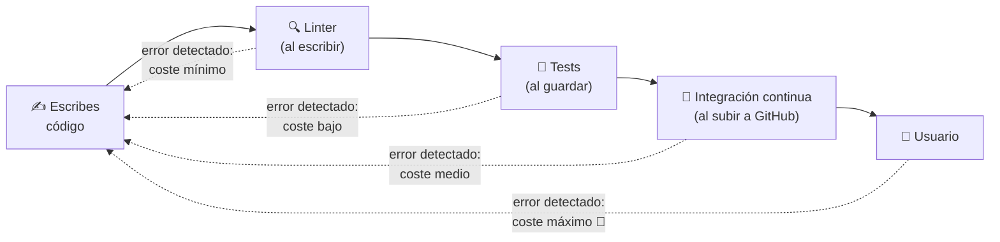
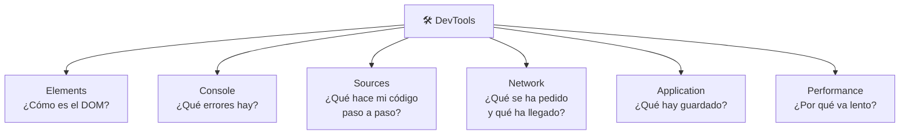
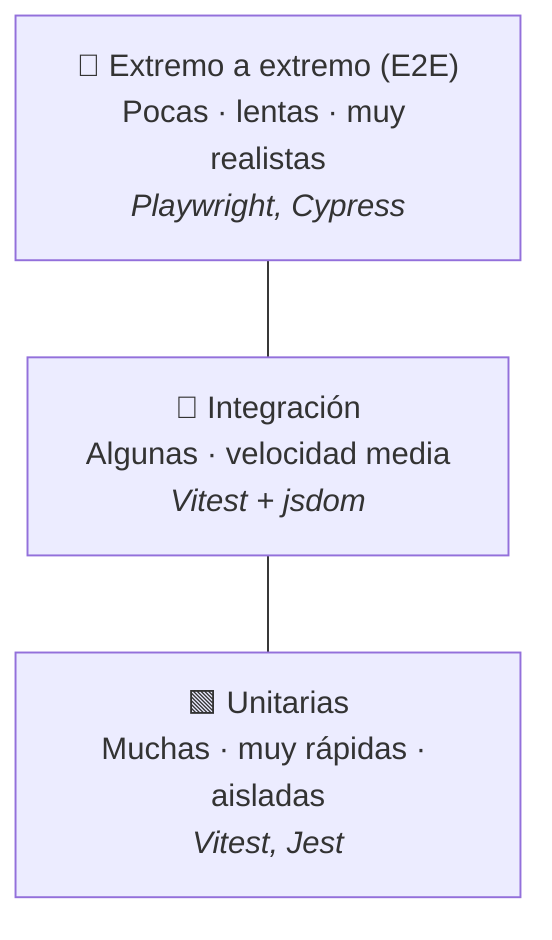
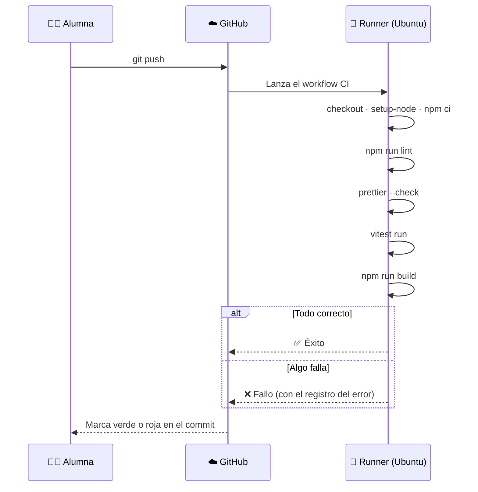
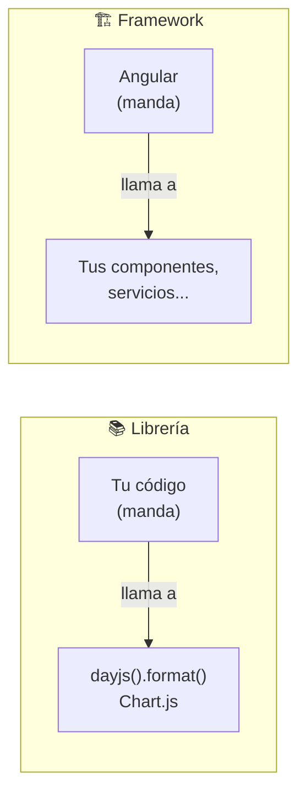
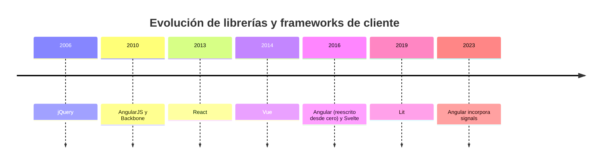

# 6. Herramientas de prueba, librerías y frameworks

[⬅️ Volver a la unidad](./README.md)

## Índice

- [6.1. ¿Por qué probar el código?](#61-por-qué-probar-el-código)
- [6.2. Las herramientas de desarrollo del navegador (DevTools)](#62-las-herramientas-de-desarrollo-del-navegador-devtools)
  - [6.2.1. Paneles principales](#621-paneles-principales)
  - [6.2.2. La consola](#622-la-consola)
  - [6.2.3. Modo dispositivo](#623-modo-dispositivo)
- [6.3. Calidad del código: linters y formateadores](#63-calidad-del-código-linters-y-formateadores)
  - [6.3.1. ESLint](#631-eslint)
  - [6.3.2. Prettier](#632-prettier)
- [6.4. Tipos de pruebas](#64-tipos-de-pruebas)
- [6.5. Pruebas unitarias con Vitest](#65-pruebas-unitarias-con-vitest)
  - [6.5.1. Anatomía de un test](#651-anatomía-de-un-test)
  - [6.5.2. Ejecutar los tests](#652-ejecutar-los-tests)
  - [6.5.3. Cuando un test falla](#653-cuando-un-test-falla)
- [6.6. Pruebas de extremo a extremo con Playwright](#66-pruebas-de-extremo-a-extremo-con-playwright)
- [6.7. Otras herramientas de análisis](#67-otras-herramientas-de-análisis)
- [6.8. Integración continua con GitHub Actions](#68-integración-continua-con-github-actions)
- [6.9. Librerías y frameworks](#69-librerías-y-frameworks)
  - [6.9.1. Librería frente a framework](#691-librería-frente-a-framework)
  - [6.9.2. Panorama actual](#692-panorama-actual)
- [6.10. Cómo evaluar una herramienta](#610-cómo-evaluar-una-herramienta)
- [6.11. Ejemplo integrador: completar la plantilla del curso](#611-ejemplo-integrador-completar-la-plantilla-del-curso)
- [Resumen](#resumen)
- [Ejercicios de reflexión](#ejercicios-de-reflexión)

> **CE que trabaja este tema:** RA1 f.

---

## 6.1. ¿Por qué probar el código?

Recuerda del tema 3 que JavaScript es un lenguaje de guion: muchos errores **no aparecen hasta que se ejecuta** la línea que falla, y a veces eso ocurre delante del usuario. Las herramientas de este tema existen para encontrar esos errores **antes**.



Cuanto **más tarde** se detecta un error, **más caro** es arreglarlo. Un error que marca el editor mientras escribes se corrige en segundos; uno que descubre un cliente en producción puede costar horas, dinero y reputación.

> 📝 **Nota del Profesor**: "Se ha probado y documentado el código" es un criterio de evaluación en casi todos los RA del módulo. Las herramientas que conoces en este tema te acompañarán todo el curso.

---

## 6.2. Las herramientas de desarrollo del navegador (DevTools)

Todos los navegadores traen herramientas para inspeccionar y depurar páginas. Se abren con `F12` o `Ctrl+Mayús+I` (en macOS, `Cmd+Opción+I`).

### 6.2.1. Paneles principales

| Panel (Chrome / Firefox) | Para qué sirve | Unidad |
|--------------------------|----------------|--------|
| **Elements** / Inspector | Ver y editar el DOM y el CSS en vivo | UD5 |
| **Console** / Consola | Ver mensajes y errores, ejecutar JavaScript | Todas |
| **Sources** / Depurador | Ver el código, poner puntos de ruptura, ejecutar paso a paso | UD2 |
| **Network** / Red | Ver cada petición HTTP, sus cabeceras, tiempos y respuesta | UD1 y UD7 |
| **Application** / Almacenamiento | Cookies, `localStorage`, IndexedDB, caché | UD4 |
| **Performance** / Rendimiento | Grabar y analizar qué hace el navegador en cada momento | Tema 2 |
| **Lighthouse** | Auditoría de rendimiento, accesibilidad, buenas prácticas y SEO | Este tema |



### 6.2.2. La consola

La consola es la herramienta más usada. Desde tu código puedes escribir en ella con el objeto `console`:

```js
console.log('Mensaje normal');
console.info('ℹ️ Información');
console.warn('⚠️ Aviso');
console.error('❌ Error');

const alumno = { nombre: 'Ana', nota: 8.5 };
console.log('Alumno:', alumno);   // se puede desplegar para inspeccionarlo
console.table([
  { nombre: 'Ana', nota: 8.5 },
  { nombre: 'Luis', nota: 6 },
]);                               // muestra una tabla

console.time('bucle');
for (let i = 0; i < 1_000_000; i++) {}
console.timeEnd('bucle');         // bucle: 3.2 ms
```

Además, en la consola puedes **escribir JavaScript** y ver el resultado al instante: es perfecta para experimentar.

> ✅ **Buena práctica**: Cuando algo no funcione, **mira primero la consola**. El mensaje de error en rojo te dice qué ha fallado, en qué fichero y en qué línea (haz clic en el enlace de la derecha para ir directamente).

### 6.2.3. Modo dispositivo

Con las DevTools abiertas, `Ctrl+Mayús+M` activa el **modo dispositivo** (en Firefox se llama *Vista de diseño adaptable*). Con él puedes simular pantallas de móvil y tableta, eventos táctiles y conexiones lentas. Imprescindible para comprobar que tu aplicación funciona en cualquier dispositivo.

---

## 6.3. Calidad del código: linters y formateadores

### 6.3.1. ESLint

Un **linter** analiza el código **sin ejecutarlo** (*análisis estático*) y avisa de errores probables y malas prácticas. El estándar en JavaScript es **ESLint**.

Ejemplo de código con problemas:

```js
var total = 0;
const precios = [10, 20, 30];

for (var i = 0; i < precios.length; i++) {
  total = total + precios[i];
}

if (total == '60') {
  console.log('Correcto');
}

function calcularIva(precio) {
  const iva = 0.21;
  return precio * 1.21;
}
```

ESLint, bien configurado, marcaría:

```text
  1:1   error  Unexpected var, use let or const instead          no-var
  4:6   error  Unexpected var, use let or const instead          no-var
  8:11  error  Expected '===' and instead saw '=='               eqeqeq
 12:10  error  'calcularIva' is defined but never used           no-unused-vars
 13:9   error  'iva' is assigned a value but never used          no-unused-vars
```

Todos son **errores reales** que JavaScript habría aceptado sin quejarse. Instalación en un proyecto:

```bash
npm install -D eslint @eslint/js globals
```

Configuración en `eslint.config.js` (en la raíz del proyecto):

```js
// eslint.config.js
import js from '@eslint/js';
import globals from 'globals';

export default [
  { ignores: ['dist/', 'coverage/'] },
  js.configs.recommended,
  {
    languageOptions: {
      ecmaVersion: 'latest',
      sourceType: 'module',
      globals: { ...globals.browser },
    },
    rules: {
      'no-var': 'error',
      'prefer-const': 'error',
      eqeqeq: 'error',
    },
  },
];
```

```bash
npx eslint .          # revisa todo el proyecto
npx eslint . --fix    # corrige automáticamente lo que pueda
```

Con la extensión de ESLint en VS Code, los errores aparecen **subrayados mientras escribes**.

### 6.3.2. Prettier

Un **formateador** no busca errores: reescribe el código con un **estilo uniforme** (sangría, comillas, espacios, saltos de línea). Así todo el equipo escribe igual y las revisiones se centran en lo importante.

```js
// Antes de Prettier
const alumno={nombre:"Ana",notas:[7,8,9],activo:true}
function media(n){return n.reduce((a,b)=>a+b,0)/n.length}
```

```js
// Después de Prettier
const alumno = { nombre: 'Ana', notas: [7, 8, 9], activo: true };
function media(n) {
  return n.reduce((a, b) => a + b, 0) / n.length;
}
```

```bash
npm install -D prettier
```

```json
// .prettierrc
{
  "singleQuote": true,
  "semi": true,
  "printWidth": 100
}
```

Prettier formatea **todo** lo que entiende, también el Markdown y el `package-lock.json`. Con un fichero `.prettierignore`, con la misma sintaxis que `.gitignore`, le dices qué no debe tocar:

```gitignore
# .prettierignore
# Prettier formatea el código: la documentación en Markdown la escribes tú
*.md
dist/
coverage/
package-lock.json
```

```bash
npx prettier --check .   # comprueba si todo está formateado (no cambia nada)
npx prettier --write .   # formatea todos los ficheros
```

`--check` termina con `All matched files use Prettier code style!` si no hay nada que cambiar; si no, lista los ficheros que formatearía. Es el que se usa en la integración continua (6.8).

| | Linter (ESLint) | Formateador (Prettier) |
|---|---|---|
| Objetivo | Encontrar **errores** y malas prácticas | Unificar el **estilo** visual |
| ¿Cambia el significado del código? | Puede sugerirlo (`var` → `let`) | Nunca |
| Ejemplo | "Variable declarada y no usada" | Poner comillas simples y punto y coma |

> 💡 **Tip del Examinador**: "¿Qué diferencia hay entre un linter y un formateador?" → El **linter** analiza el código para encontrar **errores y malas prácticas**; el **formateador** solo cambia el **aspecto** (espacios, comillas, saltos de línea) sin cambiar lo que hace.

---

## 6.4. Tipos de pruebas

Las pruebas pueden hacerse a mano (abrir la página y hacer clic) o **automatizarse**: escribir código que comprueba que tu código funciona. Las automáticas se pueden repetir en segundos cada vez que cambias algo.

Según **qué parte** del sistema prueban, se organizan en la llamada **pirámide de pruebas**:



| Tipo | Qué prueba | Ejemplo | Herramienta |
|------|-----------|---------|-------------|
| **Unitaria** | Una función o clase aislada | `calcularIva(100)` devuelve `121` | Vitest |
| **Integración** | Varias piezas juntas | Al enviar el formulario, se añade una fila a la tabla del DOM | Vitest + jsdom |
| **Extremo a extremo** (E2E) | La aplicación completa en un navegador real, como un usuario | Abrir la web, iniciar sesión, comprar y ver el pedido | Playwright |

Otras pruebas que conviene conocer:

- **Manuales / exploratorias**: una persona usa la aplicación buscando fallos.
- **De compatibilidad**: la aplicación funciona en distintos navegadores y dispositivos (UD5).
- **De accesibilidad**: se puede usar con teclado, lector de pantalla, buen contraste…
- **De rendimiento**: tiempos de carga, fluidez (Lighthouse, panel *Performance*).

---

## 6.5. Pruebas unitarias con Vitest

**Vitest** es un framework de pruebas integrado con Vite: rápido, con la misma configuración que tu proyecto y compatible con la sintaxis de Jest (el otro gran framework de pruebas de JavaScript).

```bash
npm install -D vitest
```

```json
// package.json
"scripts": {
  "test": "vitest"
}
```

### 6.5.1. Anatomía de un test

Tenemos un módulo con una función:

```js
// src/precios.js
export function precioConIva(precio, iva = 0.21) {
  if (precio < 0) {
    throw new Error('El precio no puede ser negativo');
  }
  return Math.round(precio * (1 + iva) * 100) / 100;
}
```

Y su fichero de pruebas, con el mismo nombre terminado en `.test.js`:

```js
// src/precios.test.js
import { describe, it, expect } from 'vitest';
import { precioConIva } from './precios.js';

describe('precioConIva', () => {
  it('aplica el 21 % por defecto', () => {
    expect(precioConIva(100)).toBe(121);
  });

  it('aplica el IVA indicado', () => {
    expect(precioConIva(100, 0.1)).toBe(110);
  });

  it('redondea a dos decimales', () => {
    expect(precioConIva(9.99)).toBe(12.09);
  });

  it('lanza un error si el precio es negativo', () => {
    expect(() => precioConIva(-5)).toThrow('negativo');
  });
});
```

| Pieza | Qué es |
|-------|--------|
| `describe('…', () => {…})` | Agrupa tests relacionados (normalmente, los de una función) |
| `it('…', () => {…})` (o `test`) | Un caso de prueba. La descripción dice **qué debe pasar** |
| `expect(valor)` | El valor que quieres comprobar |
| `.toBe(esperado)`, `.toEqual(…)`, `.toThrow(…)` | **Comparadores** (*matchers*): cómo debe ser ese valor |

Cada test sigue el patrón **AAA**: *Arrange* (preparar los datos), *Act* (ejecutar la función), *Assert* (comprobar el resultado). En tests tan cortos, a menudo cabe en una línea.

### 6.5.2. Ejecutar los tests

```bash
npm test
```

```text
 ✓ src/precios.test.js (4 tests) 3ms
   ✓ precioConIva > aplica el 21 % por defecto
   ✓ precioConIva > aplica el IVA indicado
   ✓ precioConIva > redondea a dos decimales
   ✓ precioConIva > lanza un error si el precio es negativo

 Test Files  1 passed (1)
      Tests  4 passed (4)
   Duration  245ms

 PASS  Waiting for file changes...
```

Vitest se queda **vigilando**: cada vez que guardas un fichero, vuelve a ejecutar los tests afectados. Pulsa `q` para salir.

### 6.5.3. Cuando un test falla

Supón que alguien "optimiza" la función y quita el redondeo:

```js
return precio * (1 + iva);
```

```text
 ❯ src/precios.test.js (4 tests | 2 failed)
   ✓ precioConIva > aplica el 21 % por defecto
   × precioConIva > aplica el IVA indicado
     → expected 110.00000000000001 to be 110 // Object.is equality
   × precioConIva > redondea a dos decimales
     → expected 12.0879 to be 12.09 // Object.is equality
   ✓ precioConIva > lanza un error si el precio es negativo

      Tests  2 failed | 2 passed (4)
```

Falla el test del redondeo, como era de esperar, pero también «aplica el IVA indicado»: `100 * 1.1` no da `110`, sino `110.00000000000001`, por cómo se guardan los decimales en binario (lo verás en la UD2). Sin el redondeo, ese error habría llegado al usuario.

El test te avisa **en el momento** de que has roto algo que antes funcionaba. A esto se le llama detectar una **regresión**.

> 📝 **Nota del Profesor**: En la UD2 ejecutarás tests que te daré hechos para comprobar tus ejercicios. A partir de la UD3 **escribirás tus propios tests**. Acostúmbrate a ver el verde ✓ como la señal de que has terminado.

---

## 6.6. Pruebas de extremo a extremo con Playwright

**Playwright** (Microsoft) automatiza navegadores reales: abre la página, hace clic, escribe y comprueba lo que se ve, como haría un usuario. Y lo hace con los **tres motores** del tema 2: **Chromium**, **Firefox** y **WebKit**.

```bash
npm init playwright@latest
```

```js
// tests/inicio.spec.js
import { test, expect } from '@playwright/test';

test('la página de inicio muestra el título', async ({ page }) => {
  await page.goto('http://localhost:5173');
  await expect(page.getByRole('heading', { level: 1 })).toHaveText('Plantilla DWEC');
});
```

El test abre `http://localhost:5173`, así que el servidor de Vite tiene que estar arrancado (`npm run dev` en otro terminal). Playwright también puede arrancarlo él solo con la opción `webServer` de su configuración.

```bash
npx playwright test
```

```text
Running 3 tests using 3 workers
  ✓ [chromium] › inicio.spec.js › la página de inicio muestra el título (512ms)
  ✓ [firefox]  › inicio.spec.js › la página de inicio muestra el título (890ms)
  ✓ [webkit]   › inicio.spec.js › la página de inicio muestra el título (743ms)

  3 passed (2.4s)
```

Un único test se ha ejecutado en tres navegadores distintos. En la UD5 lo usarás para comprobar la compatibilidad entre navegadores.

> ⚠️ **Cuidado**: Dentro de un Dev Container, Playwright necesita instalar los navegadores y sus dependencias del sistema: `npx playwright install --with-deps`.

---

## 6.7. Otras herramientas de análisis

| Herramienta | Qué hace | Dónde |
|-------------|----------|-------|
| **Lighthouse** | Puntúa rendimiento, accesibilidad, buenas prácticas y SEO, con sugerencias concretas | Panel *Lighthouse* de Chrome |
| **Validador del W3C** | Comprueba que el HTML es válido | <https://validator.w3.org> |
| **Can I use** | Qué navegadores soportan cada característica | <https://caniuse.com> |
| **MDN Web Docs** | Documentación de referencia con tablas de compatibilidad | <https://developer.mozilla.org/es> |
| **WAVE / axe DevTools** | Detectan problemas de accesibilidad | Extensiones del navegador |

---

## 6.8. Integración continua con GitHub Actions

La **integración continua** (**CI**, *Continuous Integration*) consiste en ejecutar automáticamente las comprobaciones (linter, tests, compilación) **cada vez que alguien sube código** al repositorio. Si algo falla, se sabe al momento y quién lo ha provocado.

**GitHub Actions** es el servicio de CI integrado en GitHub. Se configura con ficheros YAML en `.github/workflows/`:

```yaml
# .github/workflows/ci.yml
name: CI

on:
  push:
    branches: [main]
  pull_request:
    branches: [main]

jobs:
  calidad:
    runs-on: ubuntu-latest
    steps:
      - name: Descargar el código
        uses: actions/checkout@v7

      - name: Instalar Node.js
        uses: actions/setup-node@v7
        with:
          node-version: 24
          cache: npm

      - name: Instalar dependencias
        run: npm ci

      - name: Revisar con ESLint
        run: npm run lint

      - name: Comprobar el formato con Prettier
        run: npx prettier --check .

      - name: Ejecutar los tests
        run: npx vitest run

      - name: Compilar
        run: npm run build
```

| Concepto | Qué es | En el ejemplo |
|----------|--------|---------------|
| **Workflow** | Fichero YAML que define qué se ejecuta y cuándo | `ci.yml` |
| **Evento** (`on`) | Qué lo dispara | `push` o `pull_request` a `main` |
| **Job** | Conjunto de pasos que se ejecutan en la misma máquina | `calidad` |
| **Runner** (`runs-on`) | Máquina virtual donde se ejecuta | `ubuntu-latest` |
| **Step** | Cada paso: una acción reutilizable (`uses`) o un comando (`run`) | Descargar, instalar, revisar… |
| **Action** | Pieza reutilizable publicada por otros | `actions/checkout`, `actions/setup-node` |



En la pestaña **Actions** del repositorio verás cada ejecución con el detalle de cada paso.

> 💡 **Tip del Examinador**: `npm ci` se usa en integración continua en lugar de `npm install` porque instala **exactamente** lo que dice `package-lock.json`, sin modificarlo, y es más rápido.

---

## 6.9. Librerías y frameworks

### 6.9.1. Librería frente a framework

Ambos son código escrito por otros que reutilizas, pero la relación con tu código es distinta:

- Una **librería** (*library*) es un conjunto de funciones que **tú llamas** cuando las necesitas. Tú controlas el flujo del programa.
- Un **framework** (*marco de trabajo*) define la estructura de la aplicación y **llama a tu código** en los momentos adecuados. El framework controla el flujo: es la **inversión de control** (*"no nos llames, ya te llamaremos"*).



```js
// Librería: tú decides cuándo usarla
import dayjs from 'dayjs';
const fecha = dayjs().add(7, 'day').format('DD/MM/YYYY');
```

```ts
// Framework: Angular decide cuándo crear el componente y pintarlo
@Component({
  selector: 'app-saludo',
  template: `<h1>Hola, {{ nombre() }}</h1>`,
})
export class Saludo {
  nombre = signal('Ana');
}
```

### 6.9.2. Panorama actual

| Herramienta | Tipo | Creador | Año | Rasgos principales |
|-------------|------|---------|-----|--------------------|
| **jQuery** | Librería | John Resig | 2006 | Simplificaba el DOM y las diferencias entre navegadores. Hoy casi innecesaria, pero sigue en muchas webs antiguas |
| **React** | Librería de interfaces | Meta | 2013 | Componentes con JSX, DOM virtual. Muy usada, gran ecosistema (Next.js) |
| **Vue** | Framework progresivo | Evan You | 2014 | Curva de aprendizaje suave, plantillas HTML, reactividad (Nuxt) |
| **Angular** | Framework completo | Google | 2016 | TypeScript, todo incluido (rutas, formularios, HTTP, pruebas), signals. Muy usado en empresa |
| **Svelte** | Framework compilado | Rich Harris | 2016 | Se compila a JavaScript mínimo, sin DOM virtual (SvelteKit) |
| **Solid** | Librería de interfaces | Ryan Carniato | 2018 | JSX como React, pero sin DOM virtual: reactividad fina con señales (SolidStart) |
| **Lit** | Librería | Google | 2019 | Web Components estándar del navegador |



¿Qué aportan frente a JavaScript "a pelo"? Organización en **componentes** reutilizables, **reactividad** (la interfaz se actualiza sola al cambiar los datos), **enrutamiento** de SPA, y herramientas y convenciones para equipos grandes. ¿Qué cuestan? Una curva de aprendizaje, más peso en la página y dependencia del proyecto.

> 📝 **Nota del Profesor**: Durante casi todo el curso trabajarás **sin frameworks**, con JavaScript estándar. Es la mejor forma de entender qué hacen por ti. En la UD8 compararás los frameworks con más detalle y construirás una aplicación con **Angular**.

---

## 6.10. Cómo evaluar una herramienta

El CE f pide **reconocer y evaluar** herramientas. Evaluar no es decir "me gusta": es comparar con **criterios objetivos**. Estos son los más habituales:

| Criterio | Qué mirar | Dónde |
|----------|-----------|-------|
| **Finalidad** | ¿Resuelve el problema que tengo? | Documentación |
| **Licencia** | ¿Es libre? ¿Puedo usarla en un proyecto comercial? | Fichero `LICENSE` del repositorio |
| **Mantenimiento** | Fecha del último *release*, frecuencia de commits, *issues* abiertas | GitHub |
| **Comunidad y adopción** | Descargas semanales, estrellas, preguntas en Stack Overflow | npmjs.com, GitHub |
| **Documentación** | ¿Es clara, completa, con ejemplos? ¿Está en español? | Web oficial |
| **Curva de aprendizaje** | Tiempo hasta ser productivo | Tutoriales, experiencia propia |
| **Rendimiento y peso** | Tamaño que añade a la página, velocidad | bundlephobia.com, pruebas propias |
| **Integración** | ¿Encaja con el resto del entorno (Vite, TypeScript, CI)? | Documentación |

Un método sencillo es la **matriz de decisión ponderada**: das un peso a cada criterio según su importancia para tu proyecto, puntúas cada herramienta y multiplicas.

En cada celda va solo la **puntuación** (de 1 a 5); el total de cada herramienta es la suma de peso × puntuación:

| Criterio | Peso | Vitest | Jest |
|----------|-----:|-------:|-----:|
| Integración con Vite | 3 | 5 | 3 |
| Velocidad | 2 | 5 | 3 |
| Comunidad y adopción | 2 | 4 | 5 |
| Documentación | 1 | 4 | 5 |
| **Total** | | **37** | **30** |

Vitest: 3 × 5 + 2 × 5 + 2 × 4 + 1 × 4 = **37**. Jest: 3 × 3 + 2 × 3 + 2 × 5 + 1 × 5 = **30**.

Para un proyecto con Vite, Vitest sale ganando. Con otros pesos (por ejemplo, un proyecto antiguo que ya usa Jest), la decisión podría cambiar: **no hay una herramienta mejor en abstracto, sino una más adecuada para cada contexto**.

---

## 6.11. Ejemplo integrador: completar la plantilla del curso

Partiendo de la plantilla del tema 5 (Dev Container + Vite + Git), le añadimos las herramientas de calidad y prueba:

```text
plantilla-dwec/
├── .devcontainer/devcontainer.json
├── .github/workflows/ci.yml        ← nuevo
├── .vscode/settings.json
├── src/
│   ├── main.js
│   ├── precios.js                  ← nuevo
│   ├── precios.test.js             ← nuevo
│   └── style.css
├── .gitignore
├── .prettierignore                 ← nuevo
├── .prettierrc                     ← nuevo
├── eslint.config.js                ← nuevo
├── index.html
├── package.json
├── package-lock.json
└── README.md
```

**Paso 1.** Instala las herramientas:

```bash
npm install -D eslint @eslint/js globals prettier vitest
```

**Paso 2.** Añade los scripts a `package.json`:

```json
"scripts": {
  "dev": "vite",
  "build": "vite build",
  "preview": "vite preview",
  "test": "vitest",
  "lint": "eslint .",
  "format": "prettier --write ."
}
```

**Paso 3.** Crea `eslint.config.js` (6.3.1), `.prettierrc` y `.prettierignore` (6.3.2), `src/precios.js` y `src/precios.test.js` (6.5.1). Después, formatea todo con `npm run format`.

**Paso 4.** Comprueba que todo funciona en local:

```bash
npm run lint            # sin errores
npx prettier --check .  # All matched files use Prettier code style!
npx vitest run          # 4 tests en verde (sin quedarse vigilando, como en la CI)
npm run build           # genera dist/
```

**Paso 5.** Añade el workflow `.github/workflows/ci.yml` (6.8), haz commit y sube:

```bash
git add .
git commit -m "Añade ESLint, Prettier, Vitest e integración continua"
git push
```

**Paso 6.** Abre la pestaña **Actions** del repositorio en GitHub y comprueba que aparece la ejecución con la marca verde ✅. Después, rompe a propósito un test, sube el cambio y observa cómo la marca pasa a roja ❌.

Esta plantilla es la base de las prácticas del curso: cada práctica tendrá **entorno reproducible**, **código revisado**, **tests** y **CI**.

---

## Resumen

- Cuanto antes se detecta un error, más barato es corregirlo: **linter → tests → CI → usuario**.
- Las **DevTools** del navegador (Elements, Console, Sources, Network, Application, Performance, Lighthouse) son tu herramienta básica de depuración.
- **ESLint** (linter) encuentra errores y malas prácticas; **Prettier** (formateador) unifica el estilo.
- **Pirámide de pruebas**: muchas **unitarias** (Vitest), algunas de **integración** y pocas **de extremo a extremo** (Playwright).
- Un test con Vitest: `describe` agrupa, `it` define un caso y `expect(...).toBe(...)` comprueba.
- **GitHub Actions** ejecuta automáticamente lint, tests y compilación en cada `push` (**integración continua**).
- Una **librería** la llamas tú; un **framework** llama a tu código (**inversión de control**). Principales: React, Vue, Angular, Svelte.
- Las herramientas se **evalúan** con criterios objetivos (licencia, mantenimiento, comunidad, documentación, rendimiento, integración).

> 📝 **Nota del Profesor**: No hace falta que domines todas estas herramientas ahora. Lo importante es que sepas **qué hace cada una y para qué sirve**; las irás usando a lo largo del curso.

## Ejercicios de reflexión

1. Pasa Lighthouse a tres webs que uses a menudo. ¿Cuál tiene peor puntuación en accesibilidad? ¿Qué problemas señala?
2. ¿Por qué crees que en la pirámide hay muchas pruebas unitarias y pocas de extremo a extremo?
3. ¿Qué pasaría en un equipo de diez personas sin formateador de código? ¿Y sin integración continua?
4. Busca en npmjs.com las descargas semanales de React, Vue, Angular y Svelte. ¿Coinciden con lo que ves en las ofertas de empleo de tu zona?
5. Piensa en un caso en el que elegirías una librería pequeña en lugar de un framework completo.

---

[⬅️ Volver a la unidad](./README.md)
