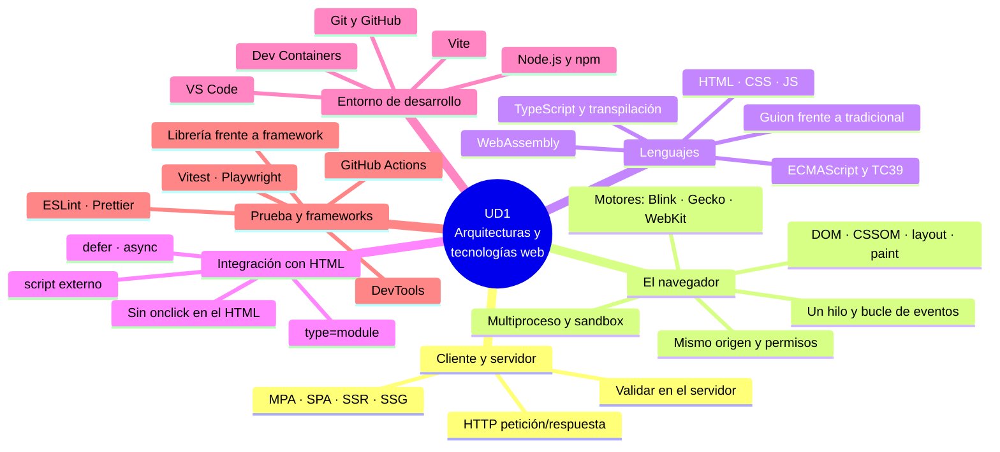

# 7. Resumen y mapa mental

[⬅️ Volver a la unidad](./README.md)

## Índice

- [Resumen ejecutivo](#resumen-ejecutivo)
- [Mapa mental](#mapa-mental)
- [Checklist de evaluación](#checklist-de-evaluación)
  - [Cliente y servidor (CE a)](#cliente-y-servidor-ce-a)
  - [El navegador (CE b)](#el-navegador-ce-b)
  - [Lenguajes y programación de guiones (CE c, d)](#lenguajes-y-programación-de-guiones-ce-c-d)
  - [Integración con HTML (CE e)](#integración-con-html-ce-e)
  - [Herramientas de programación y prueba (CE f)](#herramientas-de-programación-y-prueba-ce-f)

## Resumen ejecutivo

En esta unidad has visto **dónde y cómo se ejecuta el código de una aplicación web** y con qué herramientas se desarrolla:

1. **Cliente y servidor**: la web es una conversación HTTP de petición y respuesta. El código de servidor genera respuestas sin que el usuario lo vea; el de cliente se descarga y se ejecuta en el navegador. Modelos MPA/SSR, SPA/CSR, SSR con hidratación y SSG.
2. **El navegador**: arquitectura multiproceso, motores de renderizado (Blink, Gecko, WebKit) y de JavaScript (V8, SpiderMonkey, JavaScriptCore), ruta de renderizado (DOM, CSSOM, layout, paint), JIT, un solo hilo y bucle de eventos. Límites: sandbox, política del mismo origen y permisos.
3. **Lenguajes del cliente**: HTML, CSS y JavaScript como tres capas; ECMAScript como estándar; TypeScript y transpilación; WebAssembly. Ventajas e inconvenientes de los lenguajes de guion.
4. **Integración con HTML**: `<script>` en línea y externo, `defer`, `async`, `type="module"`, `DOMContentLoaded`, `<noscript>` y por qué no usar atributos `on…`.
5. **Entorno de desarrollo**: VS Code, Node.js y npm, Dev Containers con Docker, Vite, Git y GitHub, README.
6. **Herramientas de prueba**: DevTools, ESLint, Prettier, pirámide de pruebas, Vitest, Playwright, integración continua con GitHub Actions, librerías frente a frameworks y cómo evaluarlos.

## Mapa mental

## Checklist de evaluación

### Cliente y servidor (CE a)

- [ ] Sé explicar la arquitectura cliente-servidor y el ciclo petición-respuesta de HTTP
- [ ] Identifico las partes de una petición y de una respuesta HTTP, y los rangos de códigos de estado
- [ ] Distingo qué código se ejecuta en el servidor y qué código en el cliente, y quién puede verlo
- [ ] Sé por qué hay que validar siempre en el servidor aunque se valide en el cliente
- [ ] Diferencio MPA, SPA, SSR con hidratación y SSG, y sé cuándo conviene cada uno

### El navegador (CE b)

- [ ] Conozco la arquitectura multiproceso de un navegador y para qué sirve la sandbox
- [ ] Asocio cada navegador con su motor de renderizado y su motor de JavaScript
- [ ] Sé describir la ruta de renderizado: DOM, CSSOM, árbol de renderizado, layout, paint y composición
- [ ] Entiendo qué es la compilación JIT
- [ ] Sé por qué un bucle largo congela la página y qué papel tiene el bucle de eventos
- [ ] Conozco las limitaciones del JavaScript en el navegador: sandbox, política del mismo origen y permisos

### Lenguajes y programación de guiones (CE c, d)

- [ ] Sé qué papel tienen HTML, CSS y JavaScript en una página
- [ ] Diferencio JavaScript de ECMAScript y conozco las versiones más importantes
- [ ] Sé qué aporta TypeScript y qué es transpilar
- [ ] Sé qué es WebAssembly y para qué se usa
- [ ] Puedo enumerar ventajas e inconvenientes de los lenguajes de guion frente a la programación tradicional

### Integración con HTML (CE e)

- [ ] Sé enlazar un script externo y por qué es mejor que un script en línea
- [ ] Explico la diferencia entre un script normal, `defer`, `async` y `type="module"`
- [ ] Sé por qué los módulos necesitan un servidor
- [ ] Sé cuándo se disparan `DOMContentLoaded` y `load`
- [ ] Engancho el comportamiento con `addEventListener` y no con atributos `on…` en el HTML

### Herramientas de programación y prueba (CE f)

- [ ] Tengo el Dev Container del curso funcionando en clase y en casa
- [ ] Sé crear un proyecto con Vite, instalar dependencias con npm y usar los scripts de `package.json`
- [ ] Sé subir un proyecto a GitHub con commits pequeños y un README
- [ ] Uso los paneles principales de las DevTools
- [ ] Diferencio un linter de un formateador y tengo ESLint y Prettier configurados
- [ ] Conozco la pirámide de pruebas y sé ejecutar tests con Vitest
- [ ] Sé qué es la integración continua y he configurado un workflow de GitHub Actions
- [ ] Diferencio una librería de un framework y conozco los principales
- [ ] Sé evaluar una herramienta con criterios objetivos

> 📝 **Nota del Profesor**: Esta unidad es la base del resto del curso. Si alguna casilla se te queda sin marcar, repasa el tema correspondiente antes de empezar la UD2.

> 💡 **Tip del Examinador**: Las preguntas más frecuentes de esta unidad son: diferencia entre ejecución en cliente y en servidor, SPA frente a MPA, motores de cada navegador, `defer` frente a `async`, ventajas e inconvenientes de los lenguajes de guion, y diferencia entre librería y framework.

---

[⬅️ Volver a la unidad](./README.md)
