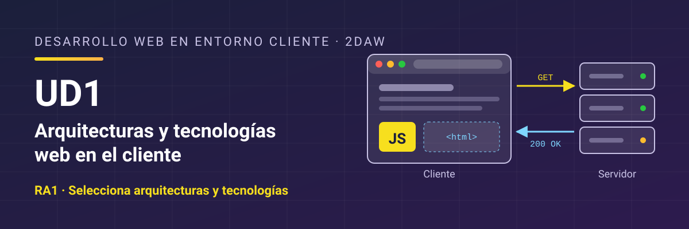

# Desarrollo Web en Entorno Cliente - UD1 Arquitecturas y tecnologías web en el cliente

Unidad 1 Arquitecturas y tecnologías web en el cliente. 2DAW.

## Resultado de aprendizaje

Esta unidad trabaja el **RA1** y sus criterios de evaluación: [ver resultado de aprendizaje y criterios de evaluación](./resultados-aprendizaje.md).

## Contenidos

1. [Cliente y servidor: dónde se ejecuta el código](./01-cliente-servidor.md)
2. [El navegador por dentro](./02-el-navegador.md)
3. [Lenguajes de programación en el cliente](./03-lenguajes-cliente.md)
4. [Integración de JavaScript con HTML](./04-integracion-html.md)
5. [El entorno de desarrollo](./05-entorno-desarrollo.md)
6. [Herramientas de prueba, librerías y frameworks](./06-herramientas-prueba.md)
7. [Resumen](./07-resumen.md)

## Licencia

Este material se distribuye bajo licencia **Creative Commons BY-NC-SA 4.0**. Consulta las condiciones en [LICENSE.md](./LICENSE.md).
